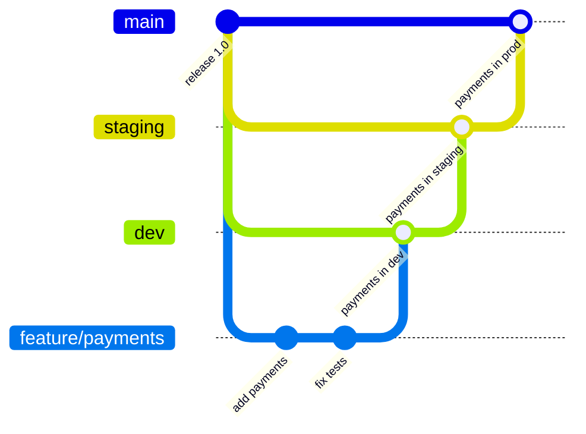
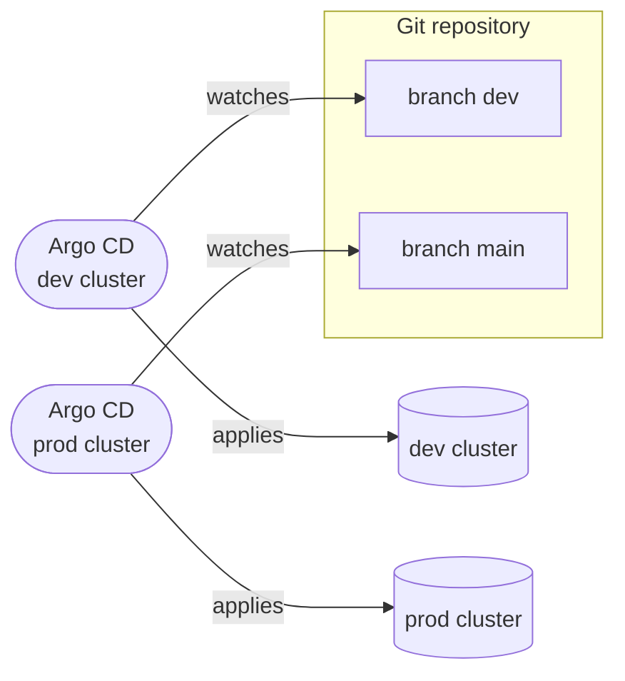
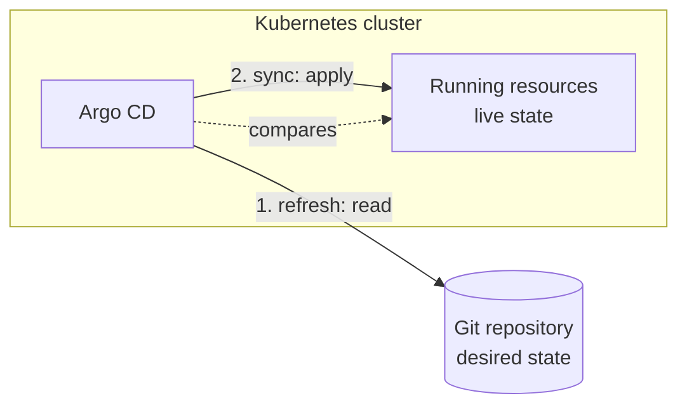
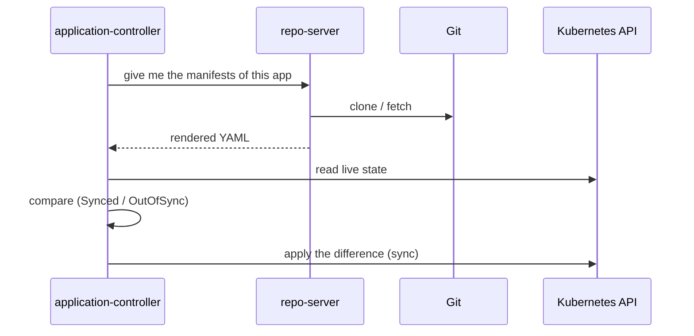

# Module 1: GitOps Fundamentals and Argo CD Architecture

## Overview

Welcome to the first module of the Argo CD on GKE Learning Path.

Before we create clusters or write any YAML, we need to agree on one idea, because everything else in this learning path starts and ends with it:

> **GitOps means the state of the cluster is whatever is in Git.**

In this module we will:

- understand what GitOps is, using a normal development workflow as the example
- see where Argo CD fits in that workflow
- look inside Argo CD: the reconciliation loop and the components that run it
- meet the `Application`, the resource we will use in almost every module

There is no hands-on part here. In the next modules we build the GKE platform and deploy our first application.

## Table of Contents

- [Lesson 1: What GitOps Is](#lesson-1-what-gitops-is)
  - [1. How Code Usually Flows](#1-how-code-usually-flows)
  - [2. Where Argo CD Fits](#2-where-argo-cd-fits)
  - [3. GitOps in One Sentence](#3-gitops-in-one-sentence)
  - [4. Automatic, but Under Control](#4-automatic-but-under-control)
  - [5. How This Learning Path Is Organized](#5-how-this-learning-path-is-organized)
- [Lesson 2: How Argo CD Works](#lesson-2-how-argo-cd-works)
  - [1. Argo CD Is a Controller](#1-argo-cd-is-a-controller)
  - [2. The Reconciliation Loop: Refresh and Sync](#2-the-reconciliation-loop-refresh-and-sync)
  - [3. The Components](#3-the-components)
  - [4. Two Resources to Learn: Application and ApplicationSet](#4-two-resources-to-learn-application-and-applicationset)
  - [5. Anatomy of an Application: Where, What and How](#5-anatomy-of-an-application-where-what-and-how)
- [Module Key Takeaways](#module-key-takeaways)

---

# Lesson 1: What GitOps Is

## 1. How Code Usually Flows

A repository is alive: people are always adding features. A simple way to picture it is as a timeline per branch.

Here is a workflow many teams use. Features start from `dev`, are validated there, go to `staging`, and finally reach `main` (production):



Your team may use trunk-based development, or no `staging` branch at all. That is fine: GitOps works with any branching model. What matters is that **each environment follows a branch, a tag or a folder in Git**.

## 2. Where Argo CD Fits

Now put an Argo CD instance next to each environment and tell it which branch to watch:



The rule is simple:

- **Everything merged into `dev` ends up in the dev cluster.**
- **Everything merged into `main` ends up in production.**

So a merge **is** a deployment. To know what is running in an environment, you don't need to run `kubectl get`, open a dashboard or check a parameter store. You just look at the branch. The branch represents the complete, desired state of the application.

## 3. GitOps in One Sentence

If you remember only one thing from this module, make it this:

> **GitOps is making sure the state of my cluster matches the state in Git, so that every operation in Git becomes an operation in the cluster.**

This also tells us what we want to avoid: manual changes. Every `kubectl edit deployment` or `kubectl apply -f` from someone's laptop creates a cluster state that Git doesn't know about. Nobody can review it, nobody can roll it back with `git revert`, and the next sync may silently undo it.

Once the state lives in Git, many things become easy:

| You want to... | With GitOps you... |
|---|---|
| Deploy | merge a pull request |
| Review a change before it goes live | review the pull request |
| Roll back | `git revert` |
| Know what is running | read the branch |
| Create a temporary environment for a feature | open a pull request (we build this later in the path) |
| Audit who changed what | read `git log` |

## 4. Automatic, but Under Control

"Every merge is a deployment" can sound scary. In practice, Argo CD lets you decide how automatic it is:

- **Manual sync.** Argo CD detects the difference between Git and the cluster, shows it, and waits for someone to press **Sync**.
- **Automated sync.** Argo CD applies the difference by itself as soon as it finds it.
- **Self-heal.** If someone changes the cluster by hand, Argo CD puts it back the way Git says.
- **Prune.** If you delete a resource from Git, Argo CD deletes it from the cluster.
- **Sync windows.** Automatic syncs are allowed only at certain times, for example never on Friday night.

Argo CD is opinionated, but its defaults are reasonable, and almost all of them can be changed.

## 5. How This Learning Path Is Organized

Everything is split into three repositories:

| Repository | What it holds |
|---|---|
| `linuxtips-gitops` | these docs: one folder per module |
| `linuxtips-gitops-gke` | Terraform and GitHub Actions that build the GKE clusters and install Argo CD |
| `linuxtips-gitops-argocd` | what Argo CD deploys: platform add-ons, demo apps and the files of each lesson |

Each module ends with something you can take to a real job, for example:

- a production-style GKE platform built by a pipeline
- a whole set of apps bootstrapped from a single Application (the app-of-apps pattern)
- canary deployments

> **Note:** We use the same rule for our own platform: **nothing is done by hand**. The clusters, Argo CD and every add-on are created by code and a pipeline. When a lesson uses the Argo CD UI to explore something, we always finish by doing the same thing through Git.

## Key Takeaways

- Each environment follows a branch (or tag, or folder) in Git, and a merge is a deployment.
- GitOps: the cluster state must match Git, and every change goes through Git.
- Manual changes in the cluster are what GitOps exists to prevent.
- How automatic a deployment is stays under your control: manual sync, automated sync, self-heal, prune and sync windows.

---

# Lesson 2: How Argo CD Works

## 1. Argo CD Is a Controller

Argo CD runs **inside** the Kubernetes cluster. In our platform it lives in the `argocd` namespace of our main GKE cluster, which we call the **hub**.

Its job is to look at something **outside** the cluster (a Git repository), and to bring what it finds back **into** the cluster:



Argo CD is a big Kubernetes controller. Everything you do in its UI or CLI ends up as Kubernetes resources and API calls inside the cluster. That includes:

- applications
- repositories
- projects
- connected clusters

## 2. The Reconciliation Loop: Refresh and Sync

Argo CD works in two steps, again and again:

| Step | Name | What happens |
|---|---|---|
| 1 | **Refresh** | Argo CD fetches Git, renders the manifests (plain YAML, Kustomize or Helm) and compares them with what is running. The result is a status: **Synced** or **OutOfSync**. |
| 2 | **Sync** | Argo CD applies the difference to the cluster, so the live state becomes the desired state. |

With a **manual** sync policy, Argo CD only does step 1 and waits for you. With an **automated** policy, it does both. The refresh runs every few minutes (3 by default), right after a Git webhook, and whenever you press **Refresh**.

Next to the sync status, every application also has a **health** status:

| Health | Meaning |
|---|---|
| Healthy | everything is running as expected |
| Progressing | still rolling out (for example, Pods starting) |
| Degraded | something failed (for example, a crash loop) |
| Missing | the resource is in Git but not in the cluster |

## 3. The Components

If you list the Pods in the `argocd` namespace, you will see these components:

| Component | What it does |
|---|---|
| `argocd-application-controller` | **The main one.** Runs the reconciliation loop: compares Git with the cluster, syncs, and computes health. When something goes wrong, its logs are the first place to look. |
| `argocd-repo-server` | Talks to Git. Clones the repositories and renders the manifests (Kustomize, Helm) that the application controller compares. |
| `argocd-server` | The API, the web UI and the endpoint the `argocd` CLI talks to. |
| `argocd-applicationset-controller` | Generates many Applications from one template. |
| `argocd-redis` | Cache only. If it is deleted, nothing is lost: Argo CD rebuilds the cache. Only very large installations need to care about it. |
| `argocd-dex-server` | Authentication. It connects Argo CD to an identity provider such as GitHub, so teams log in with their own accounts. Argo CD has no user database of its own. |
| `argocd-notifications-controller` | Sends messages about what happens, for example to Slack. |

The conversation between the two most important ones goes like this:



## 4. Two Resources to Learn: Application and ApplicationSet

Argo CD is a big tool, but most of it can be learned through two custom resources (CRDs):

- **`Application`**: deploys **one** set of manifests from Git to **one** cluster and namespace. This is the base of everything.
- **`ApplicationSet`**: a factory that **generates** many Applications from a template, for example one per cluster or one per folder. It is what teams use most in practice.

Our platform will use both: a single Application to bootstrap everything, and ApplicationSets to install the add-ons.

## 5. Anatomy of an Application: Where, What and How

An Application has three important parts. A simple way to remember them is **where**, **what** and **how**:

```yaml
# Anatomy of an Application (example)
apiVersion: argoproj.io/v1alpha1
kind: Application
metadata:
  name: podinfo
  namespace: argocd            # Applications always live where Argo CD runs
spec:
  project: default
  destination:                 # WHERE: which cluster and namespace
    name: hub
    namespace: podinfo
  source:                      # WHAT: which repo, which revision, which folder
    repoURL: https://github.com/LuisGustavoBR/linuxtips-gitops-argocd.git
    targetRevision: HEAD
    path: apps/podinfo/base
  syncPolicy:                  # HOW: the rules of the sync
    syncOptions:
      - CreateNamespace=true
```

| Part | Question it answers | Examples |
|---|---|---|
| `destination` | Where does it go? | the hub cluster, namespace `podinfo` |
| `source` | What is deployed? | a repo, a revision (`HEAD`, a branch, a tag) and a path |
| `syncPolicy` | How is it synced? | manual or automated, prune, self-heal, create the namespace |

About `targetRevision`:

- `HEAD` means the latest commit of the default branch.
- A branch name (`dev`, `main`) follows that branch.
- A tag (`v1.2.0`) pins a release.

This one field is how "each environment follows a branch" from Lesson 1 becomes real.

Soon we create exactly this Application, first in the UI to see every field, then the GitOps way.

## Key Takeaways

- Argo CD is a controller inside the cluster that pulls the desired state from Git.
- It works in a loop: **refresh** (read and compare) and **sync** (apply).
- The application controller does the comparing and syncing, the repo-server talks to Git, and Redis is only a cache.
- Two CRDs cover most of Argo CD: `Application` and `ApplicationSet`.
- An Application is **where** (`destination`), **what** (`source`) and **how** (`syncPolicy`).

---

# Module Key Takeaways

- GitOps: the cluster state matches Git, and every change goes through Git.
- A merge is a deployment, and how automatic it is stays under your control.
- Argo CD continuously refreshes (compares Git with the cluster) and syncs (applies the difference).
- Learn the `Application` well. Everything else in Argo CD builds on it.
