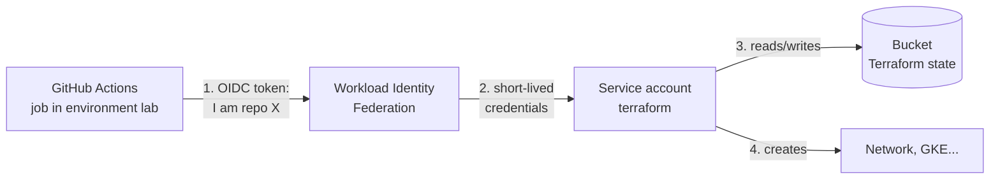
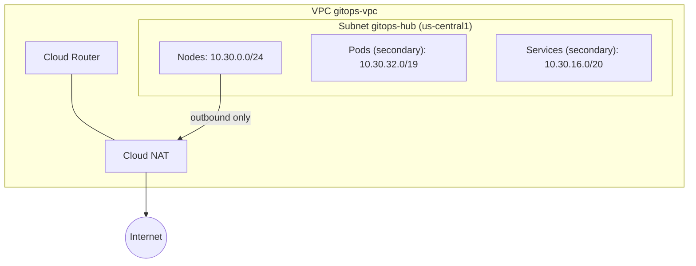
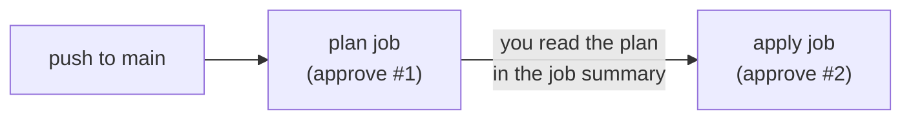
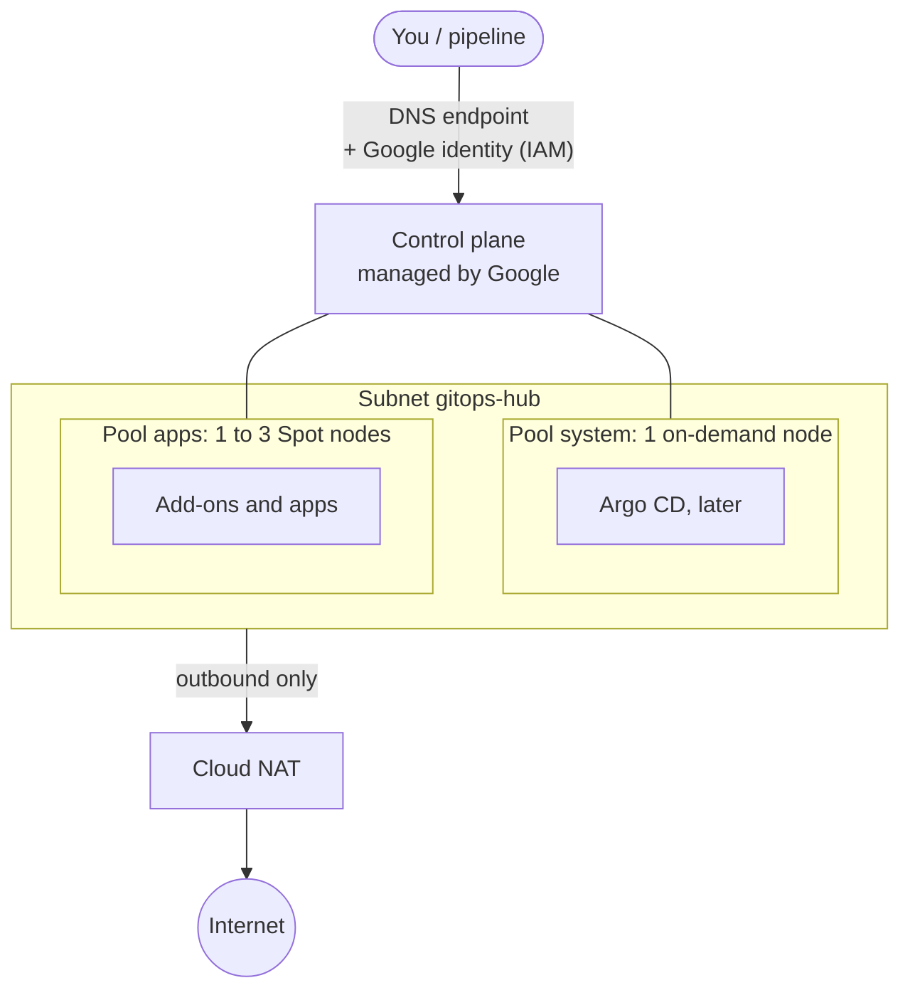
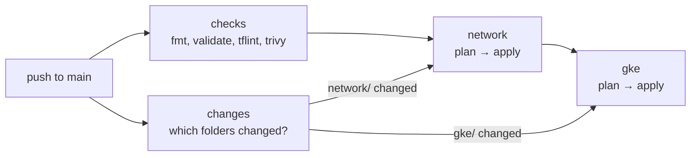

# Module 2: GKE Platform with Terraform and GitHub Actions

## Overview

In this module we build the GKE platform that the rest of the learning path runs on.

From the second lesson on, everything is created by **Terraform**, applied by a **GitHub Actions** pipeline. But before Terraform can run in a pipeline, it needs two things that it can't create for itself:

1. **A bucket to store the Terraform state.** The state is the file where Terraform records what it has created. Pipeline runners are thrown away after each run, so the state can't live on them.
2. **A way for GitHub Actions to log in to Google Cloud**, without storing a password or a key file in GitHub.

So the first lesson prepares these by hand, with `gcloud` commands in the Cloud Shell. We do it once, and the pipeline takes over from there.

## Table of Contents

- [Lesson 1: Preparing the GCP Project](#lesson-1-preparing-the-gcp-project)
  - [1. Open the Cloud Shell and Set the Variables](#1-open-the-cloud-shell-and-set-the-variables)
  - [2. Enable the APIs](#2-enable-the-apis)
  - [3. Create the State Bucket](#3-create-the-state-bucket)
  - [4. Create the Workload Identity Pool and Provider](#4-create-the-workload-identity-pool-and-provider)
  - [5. Create the Terraform Service Account](#5-create-the-terraform-service-account)
  - [6. Allow GitHub Actions to Use the Service Account](#6-allow-github-actions-to-use-the-service-account)
  - [7. Configure GitHub](#7-configure-github)
  - [8. Check Everything](#8-check-everything)
- [Lesson 2: Creating the Network](#lesson-2-creating-the-network)
  - [1. What We Are Creating](#1-what-we-are-creating)
  - [2. The Terraform Files](#2-the-terraform-files)
  - [3. The Workflow](#3-the-workflow)
  - [4. Run It](#4-run-it)
  - [5. Check the Result](#5-check-the-result)
  - [6. If Something Fails](#6-if-something-fails)
- [Lesson 3: Creating the GKE Cluster](#lesson-3-creating-the-gke-cluster)
  - [1. The Cluster We Are Creating](#1-the-cluster-we-are-creating)
  - [2. The Terraform Files](#2-the-terraform-files-1)
  - [3. A Pipeline That Grows with the Repository](#3-a-pipeline-that-grows-with-the-repository)
  - [4. Run It](#4-run-it-1)
  - [5. Connect with kubectl](#5-connect-with-kubectl)
  - [6. Destroy and Recreate the Cluster](#6-destroy-and-recreate-the-cluster)
  - [7. Troubleshooting the Cluster](#7-troubleshooting-the-cluster)

---

# Lesson 1: Preparing the GCP Project

Here is what we are going to create:



| Resource | Why |
|---|---|
| A **bucket** | stores the Terraform state |
| A **Workload Identity pool and provider** | lets GitHub Actions log in **without a key**. GitHub proves "I am a job of this repository", and Google returns credentials that expire in minutes |
| A **service account** `terraform` | the identity Terraform uses, with only the permissions it needs |

> **Note:** Why not a service account key (a JSON file stored as a GitHub secret)? A key never expires. Anyone who leaks it can use it from anywhere, until someone notices and deletes it. With Workload Identity Federation there is no key to leak.

## 1. Open the Cloud Shell and Set the Variables

Open the [Google Cloud console](https://console.cloud.google.com/), select your project and click the **Activate Cloud Shell** button (top right). The Cloud Shell is a terminal in the browser that already has `gcloud` installed and logged in with your account.

Set the variables used by every command in this lesson, changing `PROJECT_ID` to your project:

```bash
export PROJECT_ID="your-project-id"
export REGION="us-central1"
export GITHUB_OWNER="LuisGustavoBR"
export GITHUB_REPO="linuxtips-gitops-gke"

gcloud config set project "$PROJECT_ID"
export PROJECT_NUMBER=$(gcloud projects describe "$PROJECT_ID" --format='value(projectNumber)')
echo "$PROJECT_NUMBER"
```

We also need the **numeric IDs** of the GitHub owner and repository. Names can change, but these IDs never do:

```bash
export GITHUB_REPO_ID=$(curl -s "https://api.github.com/repos/${GITHUB_OWNER}/${GITHUB_REPO}" | jq -r .id)
export GITHUB_OWNER_ID=$(curl -s "https://api.github.com/repos/${GITHUB_OWNER}/${GITHUB_REPO}" | jq -r .owner.id)
echo "repo: $GITHUB_REPO_ID  owner: $GITHUB_OWNER_ID"
```

You should see two numbers. If you see `null`, check the owner and repository names (the repository must be public for this unauthenticated call).

> **Note:** If the Cloud Shell disconnects, these variables are lost. Run this block again before continuing.

## 2. Enable the APIs

A new project starts with almost every service switched off. We enable only what this module needs:

```bash
gcloud services enable \
  cloudresourcemanager.googleapis.com \
  compute.googleapis.com \
  container.googleapis.com \
  iam.googleapis.com \
  iamcredentials.googleapis.com \
  sts.googleapis.com \
  storage.googleapis.com
```

| API | Used for |
|---|---|
| `cloudresourcemanager` | reading and changing the project's IAM policy |
| `compute` | VPC, subnets, NAT, the nodes |
| `container` | GKE |
| `iam` | service accounts |
| `iamcredentials` | issuing short-lived credentials for a service account |
| `sts` | exchanging the GitHub token for Google credentials |
| `storage` | the state bucket |

It takes a minute or two. Expected output: `Operation "operations/..." finished successfully.`

## 3. Create the State Bucket

Bucket names are global across all of Google Cloud, so we prefix it with the project ID:

```bash
export BUCKET="${PROJECT_ID}-tfstate"

gcloud storage buckets create "gs://${BUCKET}" \
  --location="$REGION" \
  --uniform-bucket-level-access \
  --public-access-prevention

gcloud storage buckets update "gs://${BUCKET}" --versioning
```

| Option | Why |
|---|---|
| `--uniform-bucket-level-access` | permissions are managed only with IAM, on the whole bucket (no per-file permissions to forget about) |
| `--public-access-prevention` | the bucket can never be made public, even by mistake |
| `--versioning` | every change to the state keeps the previous version, so a broken state can be restored |

> **Note:** Terraform also needs a **lock**, so two runs never write the state at the same time. The GCS backend handles it inside the bucket itself, so there is nothing else to create.

## 4. Create the Workload Identity Pool and Provider

The **pool** is a container for external identities. The **provider** says which identity provider is trusted (GitHub) and which tokens are accepted.

```bash
gcloud iam workload-identity-pools create github \
  --location=global \
  --display-name="GitHub Actions"

gcloud iam workload-identity-pools providers create-oidc github-actions \
  --location=global \
  --workload-identity-pool=github \
  --display-name="GitHub Actions OIDC" \
  --issuer-uri="https://token.actions.githubusercontent.com" \
  --attribute-mapping="google.subject=assertion.sub,attribute.repository=assertion.repository,attribute.repository_id=assertion.repository_id" \
  --attribute-condition="assertion.repository_owner_id == '${GITHUB_OWNER_ID}' && assertion.repository_id == '${GITHUB_REPO_ID}'"
```

What the options mean:

- **`--issuer-uri`**: trust tokens signed by GitHub Actions.
- **`--attribute-mapping`**: which fields of the GitHub token Google keeps. The important one is `google.subject`, which identifies exactly which job is calling. For a job in an environment it looks like `repo:LuisGustavoBR@60719801/linuxtips-gitops-gke@1459115013:environment:lab`: owner and repository, each with its numeric ID, plus the environment.
- **`--attribute-condition`**: the security gate. **Only tokens from this repository are accepted at all.** Without it, any GitHub repository could try to log in to your pool.

> **Note:** A deleted pool stays in a "deleted" state for 30 days, and its name can't be reused during that time. If you need to start over, undelete it (`gcloud iam workload-identity-pools undelete github --location=global`) instead of creating a new one with the same name.

## 5. Create the Terraform Service Account

```bash
gcloud iam service-accounts create terraform \
  --display-name="Terraform (GitHub Actions)"

export SA_EMAIL="terraform@${PROJECT_ID}.iam.gserviceaccount.com"
```

Now give it **only** the roles the next lessons need (network and GKE):

```bash
for role in \
  roles/compute.networkAdmin \
  roles/compute.securityAdmin \
  roles/container.admin \
  roles/iam.serviceAccountAdmin \
  roles/iam.serviceAccountUser \
  roles/serviceusage.serviceUsageConsumer
do
  gcloud projects add-iam-policy-binding "$PROJECT_ID" \
    --member="serviceAccount:${SA_EMAIL}" \
    --role="$role" \
    --condition=None \
    --quiet >/dev/null
  echo "granted $role"
done
```

| Role | Used for |
|---|---|
| `compute.networkAdmin` | VPC, subnets, router, NAT |
| `compute.securityAdmin` | firewall rules |
| `container.admin` | GKE clusters and node pools |
| `iam.serviceAccountAdmin` | creating the service account the GKE nodes run as |
| `iam.serviceAccountUser` | attaching that service account to the nodes |
| `serviceusage.serviceUsageConsumer` | calling APIs billed to this project |

One more permission is special. The GKE nodes run with their own service account, which needs a couple of roles in the project. To grant them, Terraform must be able to **edit the project's IAM policy**. That role (`projectIamAdmin`) is powerful: without limits, Terraform could grant itself anything, even Owner. So we attach an **IAM condition** that lists the only roles it is allowed to grant:

```bash
cat > iam-condition.yaml <<'EOF'
title: limited-grants
description: terraform may only grant the roles the GKE node service account needs
expression: "api.getAttribute('iam.googleapis.com/modifiedGrantsByRole', []).hasOnly(['roles/container.defaultNodeServiceAccount', 'roles/artifactregistry.reader'])"
EOF

gcloud projects add-iam-policy-binding "$PROJECT_ID" \
  --member="serviceAccount:${SA_EMAIL}" \
  --role="roles/resourcemanager.projectIamAdmin" \
  --condition-from-file=iam-condition.yaml \
  --quiet >/dev/null && echo "granted projectIamAdmin (limited)"
```

Finally, access to the state bucket:

```bash
gcloud storage buckets add-iam-policy-binding "gs://${BUCKET}" \
  --member="serviceAccount:${SA_EMAIL}" \
  --role="roles/storage.objectUser"
```

`objectUser` allows reading, writing and deleting files in this bucket only. The lock also needs it, because Terraform creates and deletes a lock file.

> **Note:** When a later lesson needs more permissions (Secret Manager, for example), we add that role here, in this guide, and say why. Starting small and growing on purpose is what **least privilege** means in practice.

## 6. Allow GitHub Actions to Use the Service Account

The last link: tokens from GitHub may **impersonate** (act as) the `terraform` service account, but only when the job runs in the GitHub Environment called `lab`:

```bash
gcloud iam service-accounts add-iam-policy-binding "$SA_EMAIL" \
  --role="roles/iam.workloadIdentityUser" \
  --member="principal://iam.googleapis.com/projects/${PROJECT_NUMBER}/locations/global/workloadIdentityPools/github/subject/repo:${GITHUB_OWNER}@${GITHUB_OWNER_ID}/${GITHUB_REPO}@${GITHUB_REPO_ID}:environment:lab"
```

The member must be **exactly** the subject that GitHub puts in the job's token, character by character. GitHub writes it with the immutable IDs: `repo:<owner>@<owner_id>/<repo>@<repo_id>:environment:<env>`. That is better for us: renaming the user or the repository doesn't break the link, because the IDs never change.

> **Note:** Some repositories still receive the older format without IDs (`repo:<owner>/<repo>:environment:<env>`). If the pipeline later fails with `getAccessToken denied`, check which format your token uses (Lesson 2, section 6 shows how) and create the member with that exact text.

Why tie it to an environment? In GitHub, an **environment** can require a **reviewer**. So a job only gets these credentials after you approve the run. A pull request alone, or a commit pushed by someone else, can't change your infrastructure.

> **Note:** To keep things simple, every pipeline run that talks to Google Cloud (even a `terraform plan`) goes through the `lab` environment and needs your approval. Later we can split it into a read-only identity for plans and this one for applies.

## 7. Configure GitHub

Print the values the pipeline needs:

```bash
echo "GCP_PROJECT_ID=${PROJECT_ID}"
echo "GCP_WIF_PROVIDER=projects/${PROJECT_NUMBER}/locations/global/workloadIdentityPools/github/providers/github-actions"
echo "GCP_SERVICE_ACCOUNT=${SA_EMAIL}"
echo "TF_STATE_BUCKET=${BUCKET}"
```

In the `linuxtips-gitops-gke` repository on GitHub:

1. Go to **Settings → Secrets and variables → Actions → Variables** and create one **repository variable** for each line above (name on the left of `=`, value on the right). These values are not secret, because none of them grants access by itself, so they are variables, not secrets.
2. Go to **Settings → Environments → New environment** and create `lab`:
   - **Required reviewers**: add yourself
   - **Deployment branches and tags**: *Selected branches* → `main`

## 8. Check Everything

**The bucket.** Look for `versioning_enabled: true` and `public_access_prevention: enforced`:

```bash
gcloud storage buckets describe "gs://${BUCKET}"
```

**The provider.** It should be `ACTIVE`, with your repository ID in the condition:

```bash
gcloud iam workload-identity-pools providers describe github-actions \
  --location=global --workload-identity-pool=github \
  --format="value(state,attributeCondition)"
```

**The roles of the service account:**

```bash
gcloud projects get-iam-policy "$PROJECT_ID" \
  --flatten="bindings[].members" \
  --filter="bindings.members:serviceAccount:${SA_EMAIL}" \
  --format="table(bindings.role, bindings.condition.title)"
```

Expected output: the six roles, plus `projectIamAdmin` with the condition `limited-grants`.

**Who may impersonate it:**

```bash
gcloud iam service-accounts get-iam-policy "$SA_EMAIL"
```

Expected output: `roles/iam.workloadIdentityUser` for the `principal://.../environment:lab` member.

The real test, GitHub Actions actually logging in, happens in the next lesson, when the pipeline creates the network.

## Key Takeaways

- Terraform in a pipeline needs a remote state and a way to log in. Both are created once, by hand, before anything else.
- The state bucket has versioning (to restore a broken state) and can never be made public.
- Workload Identity Federation replaces key files: GitHub proves who it is, and Google returns short-lived credentials.
- The attribute condition makes the pool accept tokens from our repository only.
- The `terraform` service account gets only the roles it needs, and its IAM admin role is limited by a condition.
- Only jobs in the `lab` environment, which you approve, can use it.

---

# Lesson 2: Creating the Network

Now Terraform starts working, through the pipeline. The first thing we create is the network the GKE cluster will live in.

All the code is in the **[linuxtips-gitops-gke](https://github.com/LuisGustavoBR/linuxtips-gitops-gke)** repository:

```txt
# linuxtips-gitops-gke
.github/workflows/terraform.yaml   # the pipeline
network/                           # the network (a Terraform root module)
  versions.tf                      # Terraform/provider versions and the backend
  providers.tf                     # the Google provider
  variables.tf                     # declares the inputs (names, IP ranges)
  network.tf                       # the VPC and the subnet
  nat.tf                           # Cloud Router and Cloud NAT
  outputs.tf                       # what it prints at the end
  envs/
    lab.tfvars                     # the values of the lab environment
  .terraform.lock.hcl              # exact provider versions (generated, committed)
```

Each top-level folder (`network/` now, `gke/` next) is a separate Terraform project, with its own code and its own state. Keeping them apart keeps each one small, and a mistake in one can't touch the others.

## 1. What We Are Creating



| Resource | Why |
|---|---|
| **VPC** `gitops-vpc` | Our private network. In *custom mode*, Google creates no subnets by itself; we decide every range. |
| **Subnet** `gitops-hub` | Where the hub cluster lives. It has **three IP ranges** (see below). |
| **Cloud Router** + **Cloud NAT** | The nodes will have **no public IP**, so nothing on the internet can reach them directly. They still need to go *out* (pull images, clone GitHub repos), and Cloud NAT gives them that. |

**Why three IP ranges?** GKE clusters are *VPC-native*: Pods and Services get real IPs from the VPC, not from an overlay network hidden inside the cluster. So the subnet has:

| Range | CIDR | Size | Used for |
|---|---|---|---|
| primary | `10.30.0.0/24` | 256 IPs | one IP per **node** |
| `hub-pods` (secondary) | `10.30.32.0/19` | 8,192 IPs | **Pods**. GKE gives each node a block of Pod IPs. |
| `hub-services` (secondary) | `10.30.16.0/20` | 4,096 IPs | **Services** (ClusterIPs) |

The ranges must not overlap with each other, or with any network you may connect later.

## 2. The Terraform Files

**The backend.** It tells Terraform to keep the state in the bucket from Lesson 1:

```hcl
# network/versions.tf
terraform {
  required_version = "~> 1.17"

  required_providers {
    google = {
      source  = "hashicorp/google"
      version = "~> 8.11"
    }
  }

  # The state lives in the GCS bucket created by hand (docs: Module 2, Lesson 1).
  # bucket and prefix are passed by the pipeline with -backend-config,
  # so no project-specific value is committed here.
  backend "gcs" {}
}
```

The `backend "gcs" {}` block is **empty on purpose** (a *partial* backend). The bucket name is passed when the pipeline runs `terraform init`, so the code works for any project.

**The provider.** `project_id` has no default. The pipeline fills it from the GitHub variable `GCP_PROJECT_ID`, as the environment variable `TF_VAR_project_id` (Terraform reads any `TF_VAR_<name>` as the value of variable `<name>`):

```hcl
# network/providers.tf
provider "google" {
  project = var.project_id
  region  = var.region
}
```

**The VPC and the subnet:**

```hcl
# network/network.tf (comments removed)
resource "google_compute_network" "this" {
  name                    = "${var.name_prefix}-vpc"
  auto_create_subnetworks = false
  routing_mode            = "REGIONAL"
}

resource "google_compute_subnetwork" "hub" {
  name    = "${var.name_prefix}-hub"
  region  = var.region
  network = google_compute_network.this.id

  ip_cidr_range = var.nodes_cidr

  private_ip_google_access = true

  secondary_ip_range {
    range_name    = "hub-pods"
    ip_cidr_range = var.pods_cidr
  }

  secondary_ip_range {
    range_name    = "hub-services"
    ip_cidr_range = var.services_cidr
  }

  log_config {
    aggregation_interval = "INTERVAL_10_MIN"
    flow_sampling        = 0.1
    metadata             = "INCLUDE_ALL_METADATA"
  }
}
```

- `auto_create_subnetworks = false`: custom mode; only the subnets we declare exist.
- `private_ip_google_access = true`: nodes without public IPs can still reach Google APIs (Artifact Registry, Cloud Logging) over Google's internal network.
- `secondary_ip_range`: the Pod and Service ranges. The cluster will refer to them **by name** (`hub-pods`, `hub-services`).
- `log_config`: **VPC flow logs**, a record of the connections in and out of the subnet, useful to investigate network or security problems. Sampling 10% of the flows keeps the cost low.

**Cloud Router and Cloud NAT:**

```hcl
# network/nat.tf (excerpt)
resource "google_compute_router" "this" {
  name    = "${var.name_prefix}-router"
  region  = var.region
  network = google_compute_network.this.id
}

resource "google_compute_router_nat" "this" {
  name   = "${var.name_prefix}-nat"
  region = var.region
  router = google_compute_router.this.name

  nat_ip_allocate_option             = "AUTO_ONLY"
  source_subnetwork_ip_ranges_to_nat = "ALL_SUBNETWORKS_ALL_IP_RANGES"
}
```

- The **Cloud Router** is the regional piece Cloud NAT runs on.
- `AUTO_ONLY`: Google picks and manages the public IPs used for outbound traffic.
- `ALL_SUBNETWORKS_ALL_IP_RANGES`: nodes and Pods of every subnet can use the NAT.

**The values of each environment.** `variables.tf` only *declares* the inputs, with no defaults. The values live in one file per environment:

```hcl
# network/envs/lab.tfvars
region      = "us-central1"
name_prefix = "gitops"

nodes_cidr    = "10.30.0.0/24"  # 256 node IPs
services_cidr = "10.30.16.0/20" # 4,096 Service IPs
pods_cidr     = "10.30.32.0/19" # 8,192 Pod IPs
```

For now there is only `lab`. Adding another environment later (say `develop`) means a new `envs/develop.tfvars` with its own names and ranges, and the difference between the two is visible in one small file. The same code always runs everywhere; only the values change.

> **Note:** The repository's `.gitignore` ignores `*.tfvars` by default, because such files often hold secrets. We add an exception for `envs/*.tfvars`. They are committed on purpose, so **they must never contain a secret**. Even the project ID stays out: the pipeline passes it.

## 3. The Workflow

> **Note:** This is the **first version** of the workflow, for a single folder. In Lesson 3, when the cluster arrives, it is restructured into a reusable workflow that scales to many folders. The ideas explained here (environment, keyless login, partial backend) stay exactly the same.

The pipeline has two jobs. Both run in the `lab` environment, so both wait for your approval:



| Job | What it does |
|---|---|
| `plan` | logs in, runs `terraform init` and `terraform plan`, and writes the plan to the job **summary** |
| `apply` | after you read the plan and approve, logs in again and runs `terraform apply` |

The important parts:

```yaml
# .github/workflows/terraform.yaml (excerpt)
on:
  push:
    branches: [main]
    paths:
      - "network/**"
      - ".github/workflows/terraform.yaml"
  workflow_dispatch:
```

The pipeline runs on every push to `main` that changes Terraform code, or by hand (**Actions → terraform → Run workflow**). A push that only changes a README doesn't trigger it.

```yaml
# .github/workflows/terraform.yaml (excerpt)
permissions:
  contents: read

concurrency:
  group: terraform
  cancel-in-progress: false
```

- `permissions`: by default, jobs can only read the code.
- `concurrency`: two runs never happen at the same time, because they would fight over the same state. A new run waits for the previous one.

```yaml
# .github/workflows/terraform.yaml (excerpt)
  plan:
    runs-on: ubuntu-24.04
    environment: lab
    permissions:
      contents: read
      id-token: write
```

- `environment: lab` is what makes the job wait for your approval. It is also what Google checks: the service account only trusts jobs in `lab` (Lesson 1, step 6).
- `id-token: write` allows the job to ask GitHub for the OIDC token. Without it, there is nothing to exchange for Google credentials.

```yaml
# .github/workflows/terraform.yaml (excerpt)
      - name: Log in to Google Cloud (Workload Identity Federation, no keys)
        uses: google-github-actions/auth@v3.0.0
        with:
          workload_identity_provider: ${{ vars.GCP_WIF_PROVIDER }}
          service_account: ${{ vars.GCP_SERVICE_ACCOUNT }}
```

This is where the login happens: the action exchanges the GitHub token for short-lived credentials of the `terraform` service account. Every later step (and Terraform) uses them automatically.

> **Note:** Actions are pinned to an **exact version** (`@v3.0.0`), not to a floating major tag like `@v3`, which points to a new release every time one is published. Pinning means the pipeline only changes when we decide to update it. For even stricter security, you can pin to a full commit SHA: a tag can technically be moved by whoever controls the action's repository; a SHA can't.

```yaml
# .github/workflows/terraform.yaml
      - name: terraform init
        working-directory: ${{ env.TF_DIR }}
        run: |
          terraform init \
            -backend-config="bucket=${{ vars.TF_STATE_BUCKET }}" \
            -backend-config="prefix=${{ env.ENV }}/${{ env.TF_DIR }}"

      - name: terraform plan
        working-directory: ${{ env.TF_DIR }}
        run: |
          terraform plan -no-color -var-file="envs/${{ env.ENV }}.tfvars" | tee plan.txt
```

- `terraform init` completes the partial backend. The bucket comes from the GitHub variable, and the prefix is `<environment>/<folder>`, so the state goes to `gs://<bucket>/lab/network/`. Each environment and each Terraform folder gets its own state: `develop` will never overwrite `lab`, and `gke/` will never touch the state of `network/`.
- `-var-file` picks the values of the environment.
- `ENV` and `TF_DIR` are set once at the top of the workflow (`ENV: lab`, `TF_DIR: network`), so changing them in one place changes every path.

> **Note:** Why not write the bucket and prefix in `versions.tf`? Because the `backend` block **can't use variables**: Terraform reads it before any variable exists. That is why it stays empty and the values come from `-backend-config`.

> **Note:** Why does the `apply` job run a fresh `terraform apply` instead of reusing the plan from the first job? Passing a plan file between jobs means uploading it as an artifact. In a public repository anyone can download artifacts, and plan files can contain sensitive values. Since only you push to `main` and runs never overlap, a fresh apply right after you read the plan is safe enough here.

## 4. Run It

Commit and push the code:

```bash
git add .gitignore .github network
git commit -m "feat: add network and terraform pipeline"
git push
```

Then, on GitHub:

1. Open **Actions → terraform**. The run shows **Waiting**, because `plan` needs approval.
2. Click **Review deployments**, check `lab` and click **Approve and deploy**.
3. When `plan` finishes, open its **Summary** and read the plan. It should create four resources:

   ```txt
   Terraform will perform the following actions:

     # google_compute_network.this will be created
     # google_compute_router.this will be created
     # google_compute_router_nat.this will be created
     # google_compute_subnetwork.hub will be created
     ...
   Plan: 4 to add, 0 to change, 0 to destroy.
   ```

4. Now `apply` is waiting. Approve it the same way. It takes a minute or two and ends with:

   ```txt
   Apply complete! Resources: 4 added, 0 changed, 0 destroyed.

   Outputs:

   hub_secondary_ranges = {
     "pods" = "hub-pods"
     "services" = "hub-services"
   }
   hub_subnet = "gitops-hub"
   network = "gitops-vpc"
   ```

## 5. Check the Result

In the Cloud Shell (set `PROJECT_ID` again if the session is new):

```bash
gcloud compute networks list --filter="name=gitops-vpc"
gcloud compute networks subnets describe gitops-hub --region us-central1 \
  --format="yaml(ipCidrRange, privateIpGoogleAccess, secondaryIpRanges)"
gcloud compute routers nats list --router gitops-router --region us-central1
```

The subnet should show `10.30.0.0/24`, `privateIpGoogleAccess: true` and the two secondary ranges.

The state written by the pipeline is in the bucket:

```bash
gcloud storage ls "gs://${PROJECT_ID}-tfstate/lab/network/"
```

```txt
gs://your-project-id-tfstate/lab/network/default.tfstate
```

From now on, every change to `network/` reads and updates that file.

## 6. If Something Fails

Login problems break in the **"Log in to Google Cloud"** step or in `terraform init`, before Terraform even reads the code. They point to a step of Lesson 1:

| Error | Likely cause | Fix |
|---|---|---|
| `The given credential is rejected by the attribute condition` | the repository or owner ID in the provider condition is wrong | Lesson 1, steps 1 and 4: check `GITHUB_REPO_ID` / `GITHUB_OWNER_ID` |
| `Permission 'iam.serviceAccounts.getAccessToken' denied` (usually in `terraform init`) | the `principal://` member of the service account doesn't match the token's subject exactly (format, repo name or environment), or the `GCP_SERVICE_ACCOUNT` variable points to a service account that doesn't exist | see [the subject GitHub sends](#seeing-the-subject-github-sends) below, then fix Lesson 1, step 6 |
| `Unable to retrieve ... id-token` / `ACTIONS_ID_TOKEN_REQUEST_URL` missing | the job lacks `id-token: write` | check the job's `permissions` |
| `storage.objects.list access ... denied` in `terraform init` | the service account can't use the bucket | Lesson 1, step 5 (bucket binding) |
| `Error: No value for required variable "project_id"` | the `GCP_PROJECT_ID` GitHub variable is missing or misspelled | Lesson 1, step 7 |
| Job stuck in **Waiting** | it is waiting for your approval | **Review deployments** |

> **Note:** The login step only exchanges the GitHub token for a Google *federated* token, and it succeeds even if the service account link is wrong. The service account is impersonated the first time something uses it, which is `terraform init`. That's why a wrong link shows up there.

### Seeing the Subject GitHub Sends

If you get `getAccessToken denied` and the member in Lesson 1, step 6 looks right, compare it with what GitHub really sends. Add this temporary step to the `plan` job, right before the login step:

```yaml
# .github/workflows/terraform.yaml (temporary debug step)
      - name: Debug OIDC claims (temporary)
        env:
          WIF_PROVIDER: ${{ vars.GCP_WIF_PROVIDER }}
          SERVICE_ACCOUNT: ${{ vars.GCP_SERVICE_ACCOUNT }}
        run: |
          echo "GCP_WIF_PROVIDER    = [${WIF_PROVIDER}]"
          echo "GCP_SERVICE_ACCOUNT = [${SERVICE_ACCOUNT}]"
          TOKEN=$(curl -s -H "Authorization: bearer ${ACTIONS_ID_TOKEN_REQUEST_TOKEN}" \
            "${ACTIONS_ID_TOKEN_REQUEST_URL}&audience=debug" | jq -r .value)
          python3 -c '
          import sys, json, base64
          p = sys.argv[1].split(".")[1]
          p += "=" * (-len(p) % 4)
          c = json.loads(base64.urlsafe_b64decode(p))
          keys = ["sub", "environment", "repository", "repository_id", "repository_owner_id", "ref"]
          print(json.dumps({k: c.get(k) for k in keys}, indent=2))
          ' "$TOKEN"
```

It prints the two variables between brackets (so a stray space shows up) and the claims of the token. It never prints the token itself, and the token it requests has the audience `debug`, so it couldn't log in to Google Cloud anyway. Example output:

```txt
GCP_WIF_PROVIDER    = [projects/302737505132/locations/global/workloadIdentityPools/github/providers/github-actions]
GCP_SERVICE_ACCOUNT = [terraform@your-project-id.iam.gserviceaccount.com]
{
  "sub": "repo:LuisGustavoBR@60719801/linuxtips-gitops-gke@1459115013:environment:lab",
  "environment": "lab",
  ...
}
```

The member of the service account must end with exactly the `sub` value. If it doesn't, add a member with the right text (Lesson 1, step 6), remove the wrong one with `remove-iam-policy-binding`, wait a minute and re-run. Then delete the debug step.

Problems with the network itself show up later, in `plan` or `apply`:

| Error | Likely cause | Fix |
|---|---|---|
| `Compute Engine API has not been used in project ... or it is disabled` | the `compute` API is not enabled | Lesson 1, step 2 |
| `Required 'compute.networks.create' permission` | the service account lacks `compute.networkAdmin` | Lesson 1, step 5 |
| `Invalid IPCidrRange` / `... overlaps with ...` | a range in `envs/lab.tfvars` is invalid or overlaps another one | fix the CIDRs in `envs/lab.tfvars` |
| `No value for required variable "nodes_cidr"` (or another one) | the variable is missing from `envs/lab.tfvars` | add it to the file |

## Key Takeaways

- The platform is split into Terraform folders at the repository root, each with its own code and its own state; the first one is `network/`.
- GKE is VPC-native: the subnet has a primary range for nodes and secondary ranges for Pods and Services.
- Nodes will have no public IP; Cloud NAT gives them outbound internet access, and Private Google Access reaches Google APIs internally.
- A partial backend keeps project-specific values out of the code; the pipeline passes them to `terraform init`.
- `variables.tf` declares the inputs and `envs/<env>.tfvars` holds the values of each environment: same code everywhere, only the values change.
- `environment: lab` makes every job wait for your approval and is what lets it use the service account; `id-token: write` plus `google-github-actions/auth` is the whole keyless login.

---

# Lesson 3: Creating the GKE Cluster

With the network in place, we create the cluster everything else runs on. We call it the **hub**: later it will run Argo CD and manage other clusters.

The code is a new folder in **[linuxtips-gitops-gke](https://github.com/LuisGustavoBR/linuxtips-gitops-gke)**, following the same pattern as `network/`:

```txt
# linuxtips-gitops-gke
.github/workflows/     # restructured in this lesson (section 3)
.tflint.hcl
.trivyignore.yaml
network/               # Lesson 2
gke/
  versions.tf          # same as network/ (backend "gcs" {})
  providers.tf
  variables.tf         # declares the inputs
  data.tf              # looks up the network created by network/
  service_account.tf   # the identity of the nodes
  cluster.tf           # the cluster
  node_pools.tf        # the two node pools
  outputs.tf
  envs/lab.tfvars      # the values of the lab environment
```

## 1. The Cluster We Are Creating



| Choice | What we use | Why |
|---|---|---|
| Mode | GKE **Standard** | We manage the node pools ourselves, which is how we learn what runs where. (Autopilot hides the nodes.) |
| Location | **Zonal** (`us-central1-a`) | The GKE free tier credit covers the cluster fee of **one** zonal cluster per billing account. We only pay for the nodes. |
| Nodes | **Private** (no public IP) | Nothing on the internet can reach them. They go out through the Cloud NAT from Lesson 2. |
| Control plane access | **DNS endpoint**, IP endpoint off | `kubectl` and the pipeline reach the cluster with a Google identity. No bastion, no VPN, no IP allowlist. |
| Pod identity | **Workload Identity** | Pods can call Google APIs without key files, the same idea as the GitHub login from Lesson 1. |
| Networking | **Dataplane V2** | eBPF-based networking with NetworkPolicy built in. |
| Exposing apps | **Gateway API** on | The modern way to expose services. We use it later for Argo CD. |
| Upgrades | release channel **REGULAR** | Google upgrades the cluster automatically to tested versions. |

**Two node pools:**

| Pool | Nodes | Why |
|---|---|---|
| `system` | 1 × `e2-standard-2`, **on-demand** | Argo CD will run here, on a node that never disappears. |
| `apps` | 1 to 3 × `e2-standard-4`, **Spot** | Spot VMs cost much less, but Google can reclaim them at any time. Good for workloads that can restart. |

## 2. The Terraform Files

**Finding the network.** `gke/` doesn't read the state of `network/`. It looks the network up by name instead, so the two folders stay independent:

```hcl
# gke/data.tf
data "google_compute_network" "this" {
  name = "${var.name_prefix}-vpc"
}

data "google_compute_subnetwork" "hub" {
  name   = "${var.name_prefix}-hub"
  region = var.region
}
```

**The identity of the nodes.** Without a dedicated service account, GKE nodes use the Compute Engine default service account, which is **Editor** on the whole project. Ours only gets what nodes need:

```hcl
# gke/service_account.tf
resource "google_service_account" "nodes" {
  account_id   = "${var.name_prefix}-hub-nodes"
  display_name = "GKE nodes of ${var.name_prefix}-hub"
}

resource "google_project_iam_member" "nodes" {
  for_each = toset([
    "roles/container.defaultNodeServiceAccount",
    "roles/artifactregistry.reader",
  ])

  project = var.project_id
  role    = each.value
  member  = google_service_account.nodes.member
}
```

These are exactly the two roles the `terraform` service account is allowed to grant (the IAM condition from Lesson 1, step 5).

**The cluster** (the most important parts):

```hcl
# gke/cluster.tf (excerpt)
resource "google_container_cluster" "hub" {
  name     = "${var.name_prefix}-hub"
  location = var.zone

  deletion_protection = false

  network         = data.google_compute_network.this.self_link
  subnetwork      = data.google_compute_subnetwork.hub.self_link
  networking_mode = "VPC_NATIVE"

  ip_allocation_policy {
    cluster_secondary_range_name  = "hub-pods"
    services_secondary_range_name = "hub-services"
  }

  datapath_provider = "ADVANCED_DATAPATH"

  private_cluster_config {
    enable_private_nodes = true
  }

  control_plane_endpoints_config {
    dns_endpoint_config {
      allow_external_traffic = true
    }
    ip_endpoints_config {
      enabled = false
    }
  }

  workload_identity_config {
    workload_pool = "${var.project_id}.svc.id.goog"
  }

  gateway_api_config {
    channel = "CHANNEL_STANDARD"
  }
  ...
}
```

What each block does:

- **No default node pool.** `initial_node_count` and `node_config` are left out on purpose, so GKE doesn't create a default pool. Our pools are separate resources, which can be changed without recreating the cluster.
- **`deletion_protection = false`**: this is a lab, destroyed and recreated often. In production you would leave it `true`.
- **`ip_allocation_policy`**: uses the two secondary ranges from Lesson 2 **by name** (`hub-pods`, `hub-services`).
- **`control_plane_endpoints_config`**: turns on the DNS endpoint and turns off the IP endpoint. Every request to the API server is authorised by IAM.

The rest of the file:

- **`logging_config` / `monitoring_config`** send only system logs and metrics, to keep costs low. Managed Prometheus is off, because we install our own monitoring later.
- **`resource_labels`** show up in the billing report.

**The node pools.** Both have the same hardening. The differences are the machine, Spot, and autoscaling:

```hcl
# gke/node_pools.tf (excerpt: the apps pool)
resource "google_container_node_pool" "apps" {
  name     = "apps"
  location = var.zone
  cluster  = google_container_cluster.hub.name

  initial_node_count = var.apps_min_nodes

  autoscaling {
    min_node_count = var.apps_min_nodes
    max_node_count = var.apps_max_nodes
  }

  network_config {
    enable_private_nodes = true
  }

  node_config {
    machine_type    = var.apps_machine_type
    spot            = true
    service_account = google_service_account.nodes.email
    ...
    workload_metadata_config {
      mode = "GKE_METADATA"
    }

    shielded_instance_config {
      enable_secure_boot          = true
      enable_integrity_monitoring = true
    }
  }

  lifecycle {
    ignore_changes = [initial_node_count]
  }
}
```

- **`spot = true`**: cheap VMs that Google can reclaim.
- **`autoscaling`**: GKE adds nodes (up to 3) when Pods don't fit, and removes them when they are idle.
- **`network_config.enable_private_nodes`**: repeated on each pool, so the nodes are private even if the cluster-level setting doesn't reach the pool.
- **`GKE_METADATA`**: Pods see only their own Workload Identity, never the node's service account.
- **`shielded_instance_config`**: Secure Boot checks that the node boots only signed software.
- **`ignore_changes = [initial_node_count]`**: the autoscaler changes the node count, and Terraform must not fight it.

The `system` pool is the same without Spot and without autoscaling (`node_count = 1`).

**The values of the lab:**

```hcl
# gke/envs/lab.tfvars
region      = "us-central1"
zone        = "us-central1-a"
name_prefix = "gitops"

system_machine_type = "e2-standard-2"

apps_machine_type = "e2-standard-4"
apps_min_nodes    = 1
apps_max_nodes    = 3
```

`name_prefix` must be the same as in `network/envs/lab.tfvars`, because that is how `gke/` finds the network.

## 3. A Pipeline That Grows with the Repository

In Lesson 2 the workflow handled a single folder. With a second folder, and more to come (Argo CD is next), a pipeline that runs everything on every push doesn't scale:

- every push plans and applies every folder, even the ones that didn't change
- the plan of `gke/` would be computed **before** `network/` is applied, so it could be based on an old network
- one failure mixes the logs of every folder, and you can't re-run just one part

So we restructure the pipeline the way companies do, using only GitHub Actions:

```txt
# linuxtips-gitops-gke
.github/workflows/
  _terraform.yaml      # reusable: plan + apply of ONE folder
  terraform.yaml       # orchestrates: checks, detect changes, network → gke
  destroy.yaml         # calls _terraform.yaml with destroy: true
.tflint.hcl            # lint rules (Terraform + Google)
.trivyignore.yaml      # accepted security findings, each one explained
```



**The reusable workflow.** `_terraform.yaml` is triggered by `workflow_call`: it is never started by a push, only called by other workflows, with the folder as an input. The `_` prefix is just a convention that marks it as internal.

```yaml
# .github/workflows/_terraform.yaml (excerpt)
on:
  workflow_call:
    inputs:
      dir:
        description: Terraform folder (network, gke...)
        type: string
        required: true
      env:
        description: Environment (GitHub Environment, envs/<env>.tfvars and state prefix)
        type: string
        default: lab
      destroy:
        description: Plan and apply a destroy instead of a normal change
        type: boolean
        default: false
```

Inside, it has the same `plan` and `apply` jobs from Lesson 2, now using `inputs.dir` and `inputs.env`. The state prefix stays `<env>/<dir>`. With `destroy: true`, it runs `plan -destroy` and `apply -destroy` instead.

**The checks job.** It runs first, **without** cloud credentials and **without** approval. A formatting error, an invalid attribute or a security problem stops the run before you are asked to approve anything:

| Step | Catches |
|---|---|
| `terraform fmt -check` | unformatted code |
| `terraform validate` | invalid syntax, unknown attributes, wrong types |
| `tflint` (Google ruleset) | invalid machine types and regions, unused variables, deprecated syntax |
| `trivy config` | security misconfigurations (public buckets, missing encryption, open firewalls...) |

Trivy found one item that doesn't apply to us. Instead of turning the check off, we accept it explicitly, with the reason:

```yaml
# .trivyignore.yaml
misconfigurations:
  - id: GCP-0061
    paths:
      - "gke/cluster.tf"
    statement: >-
      Master authorized networks only filter the IP-based control-plane endpoint, which is
      disabled. The cluster is reached only through its DNS endpoint, authorised by IAM.
```

> **Note:** Trivy is downloaded from its release page and checked against a fixed SHA-256 checksum (`TRIVY_SHA256`). If the file were ever replaced by a malicious one, the checksum wouldn't match and the step would fail.

**Detecting changes.** The `changes` job compares the pushed commits (`git diff` between the previous and the new commit) and outputs `true` or `false` for each folder:

```yaml
# .github/workflows/terraform.yaml (excerpt)
          for dir in network gke; do
            if [ "$all" = "true" ] || grep -q "^$dir/" <<<"$changed"; then value=true; else value=false; fi
            echo "$dir=$value" >>"$GITHUB_OUTPUT"
          done
```

Every folder runs (`all=true`) when:
- the run was started by hand
- it is the first push of a branch
- a workflow or a lint/security config changed, since those affect everything

**Calling the reusable workflow.** Each folder is one small job:

```yaml
# .github/workflows/terraform.yaml (excerpt)
  network:
    needs: [checks, changes]
    if: needs.changes.outputs.network == 'true'
    uses: ./.github/workflows/_terraform.yaml
    with:
      dir: network
    permissions:
      contents: read
      id-token: write

  gke:
    needs: [checks, changes, network]
    if: ${{ !failure() && !cancelled() && needs.changes.outputs.gke == 'true' }}
    uses: ./.github/workflows/_terraform.yaml
    with:
      dir: gke
    permissions:
      contents: read
      id-token: write
```

- **`needs: [..., network]`** makes `gke` wait for `network`. Its plan is computed only **after** the network is applied, so it never sees an old network.
- **`!failure() && !cancelled()`**: by default, a job is skipped when a job it needs was skipped. This condition says "run if nothing failed", so `gke` still runs when only `gke/` changed and `network` was skipped. If `network` fails, `gke` doesn't run.
- **`permissions`**: a called workflow can never have more permissions than the job that calls it, so `id-token: write` must be granted here too.
- Adding the next folder (Argo CD) is one more job like these.

> **Note:** Approvals are now per folder: `plan` and `apply` of each one. A push that changes one folder asks for two approvals. When two folders are waiting together, you can approve both in the same **Review deployments** dialog.

## 4. Run It

```bash
git add .github .tflint.hcl .trivyignore.yaml gke
git commit -m "feat: add gke cluster and reusable terraform pipeline"
git push
```

Since this push changes the workflows, **every folder runs**:

1. `checks` and `changes` run on their own (no approval). Wait for `checks` to pass.
2. **network / plan** waits for approval. Approve it: the plan says `No changes`. Approve **network / apply** as well (it changes nothing).
3. **gke / plan** waits for approval. Approve it and read the summary. Six resources to create:

   ```txt
     # google_container_cluster.hub will be created
     # google_container_node_pool.apps will be created
     # google_container_node_pool.system will be created
     # google_project_iam_member.nodes["roles/artifactregistry.reader"] will be created
     # google_project_iam_member.nodes["roles/container.defaultNodeServiceAccount"] will be created
     # google_service_account.nodes will be created
   ...
   Plan: 6 to add, 0 to change, 0 to destroy.
   ```

4. Approve **gke / apply**. Creating a GKE cluster takes about **10 minutes**: the control plane first, then the node pools. It ends with:

   ```txt
   Apply complete! Resources: 6 added, 0 changed, 0 destroyed.

   Outputs:

   cluster_location = "us-central1-a"
   cluster_name = "gitops-hub"
   get_credentials = "gcloud container clusters get-credentials gitops-hub --location us-central1-a --project your-project-id --dns-endpoint"
   ```

From now on, a push that changes only `gke/` runs only the `gke` jobs.

## 5. Connect with kubectl

The Cloud Shell already has `kubectl` and the GKE auth plugin. Copy the `get_credentials` command from the output:

```bash
gcloud container clusters get-credentials gitops-hub \
  --location us-central1-a --project "$PROJECT_ID" --dns-endpoint
```

`--dns-endpoint` connects through the DNS endpoint, with your Google identity. You can do it from anywhere: the Cloud Shell, your laptop or the pipeline.

List the nodes, showing which pool each one belongs to and whether it is Spot:

```bash
kubectl get nodes -L node-pool,cloud.google.com/gke-spot
```

```txt
NAME                                     STATUS   ROLES    AGE   VERSION   NODE-POOL   GKE-SPOT
gke-gitops-hub-apps-1a2b3c4d-x7k2        Ready    <none>   4m    v1.xx.x   apps        true
gke-gitops-hub-system-5e6f7a8b-p9qz      Ready    <none>   5m    v1.xx.x   system
```

One `system` node and one Spot `apps` node: the cluster is ready.

To confirm the nodes have no public IP (the `EXTERNAL-IP` column is `<none>`):

```bash
kubectl get nodes -o wide
```

## 6. Destroy and Recreate the Cluster

The cluster fee is covered by the free tier credit, but **the nodes cost money while they run**, even if nothing is deployed. As a rough reference, in `us-central1` an on-demand `e2-standard-2` costs around US$ 49/month and a Spot `e2-standard-4` around US$ 60/month. Check current prices in the [pricing calculator](https://cloud.google.com/products/calculator). Left running all the time, the lab costs a few dollars a day.

So when you finish studying, destroy the cluster:

1. **Actions → destroy-gke → Run workflow**.
2. Approve **gke / plan** and check the summary: `Plan: 0 to add, 0 to change, 6 to destroy.`
3. Approve **gke / apply**.

The workflow destroys **only `gke/`**. The network stays: it costs almost nothing idle, and keeping it makes the next start faster. It is the same reusable workflow, called with `destroy: true`:

```yaml
# .github/workflows/destroy.yaml (excerpt)
jobs:
  gke:
    uses: ./.github/workflows/_terraform.yaml
    with:
      dir: gke
      destroy: true
    permissions:
      contents: read
      id-token: write
```

To bring the cluster back: **Actions → terraform → Run workflow**. Since everything is code, the new cluster is identical to the old one.

> **Note:** `destroy.yaml` uses the same `concurrency` group as `terraform.yaml`, so a destroy and an apply never run at the same time.

## 7. Troubleshooting the Cluster

| Error | Likely cause | Fix |
|---|---|---|
| `Error reading Network` / `subnetwork not found` | `network/` was not applied, or `name_prefix` differs between the two `lab.tfvars` | apply `network/` first; use the same `name_prefix` |
| `Permission 'iam.serviceAccounts.actAs' denied` | the `terraform` service account can't attach the node service account | Lesson 1, step 5: `roles/iam.serviceAccountUser` |
| `Policy update access denied` / `setIamPolicy` on the project | the IAM condition doesn't allow one of the node roles | Lesson 1, step 5: check the condition lists both roles |
| `Kubernetes Engine API has not been used` | the `container` API is not enabled | Lesson 1, step 2 |
| `ZONE_RESOURCE_POOL_EXHAUSTED` or Spot nodes not starting | the zone has no free capacity for that machine type right now | wait and re-run, or try another zone in `lab.tfvars` |
| `Quota 'CPUS' exceeded` | new projects have low CPU quotas | request more quota (IAM & Admin → Quotas) or use smaller machines |
| `checks` fails in `terraform fmt` | the code isn't formatted | run `terraform fmt -recursive` locally and push |
| `checks` fails in `trivy` | a new security finding | fix the code, or (only if it really doesn't apply) add it to `.trivyignore.yaml` with the reason |
| `kubectl`: `connection refused` / `Unable to connect` | `get-credentials` was run without `--dns-endpoint` | run it again with `--dns-endpoint` |

## Key Takeaways

- The hub is a zonal GKE Standard cluster: the free tier covers its fee, and we pay only for the nodes.
- Nodes are private, and the control plane is reached only through its DNS endpoint with IAM. No bastion and no IP allowlists.
- The nodes run with a dedicated, minimal service account, never the Editor-level default one.
- On-demand `system` pool for what must stay up, Spot `apps` pool for everything else.
- `gke/` finds the network by name, so each folder keeps its own state.
- The pipeline runs static checks first (no credentials, no approval), then only the folders that changed, in order, through one reusable workflow.
- The same reusable workflow, with `destroy: true`, powers a manual button that destroys the cluster to save money.
