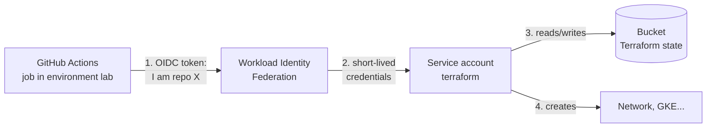

# Module 2: GKE Platform with Terraform and GitHub Actions

## Overview

In this module we build the GKE platform that the rest of the learning path runs on.

From the second lesson on, everything is created by **Terraform**, applied by a **GitHub Actions** pipeline. But before Terraform can run in a pipeline, it needs two things that it can't create for itself:

1. **A bucket to store the Terraform state.** The state is the file where Terraform records what it has created. Pipeline runners are thrown away after each run, so the state can't live on them.
2. **A way for GitHub Actions to log in to Google Cloud**, without storing a password or a key file in GitHub.

So the first lesson prepares these by hand, with `gcloud` commands in the Cloud Shell. We do it once, and the pipeline takes over from there.

## Table of Contents

- [Lesson 1: Preparing the GCP Project](#lesson-1-preparing-the-gcp-project)
  - [1. Open the Cloud Shell and Set the Variables](#1-open-the-cloud-shell-and-set-the-variables)
  - [2. Enable the APIs](#2-enable-the-apis)
  - [3. Create the State Bucket](#3-create-the-state-bucket)
  - [4. Create the Workload Identity Pool and Provider](#4-create-the-workload-identity-pool-and-provider)
  - [5. Create the Terraform Service Account](#5-create-the-terraform-service-account)
  - [6. Allow GitHub Actions to Use the Service Account](#6-allow-github-actions-to-use-the-service-account)
  - [7. Configure GitHub](#7-configure-github)
  - [8. Check Everything](#8-check-everything)

---

# Lesson 1: Preparing the GCP Project

Here is what we are going to create:



| Resource | Why |
|---|---|
| A **bucket** | stores the Terraform state |
| A **Workload Identity pool and provider** | lets GitHub Actions log in **without a key**. GitHub proves "I am a job of this repository", and Google returns credentials that expire in minutes |
| A **service account** `terraform` | the identity Terraform uses, with only the permissions it needs |

> **Note:** Why not a service account key (a JSON file stored as a GitHub secret)? A key never expires. Anyone who leaks it can use it from anywhere, until someone notices and deletes it. With Workload Identity Federation there is no key to leak.

## 1. Open the Cloud Shell and Set the Variables

Open the [Google Cloud console](https://console.cloud.google.com/), select your project and click the **Activate Cloud Shell** button (top right). The Cloud Shell is a terminal in the browser that already has `gcloud` installed and logged in with your account.

Set the variables used by every command in this lesson, changing `PROJECT_ID` to your project:

```bash
export PROJECT_ID="your-project-id"
export REGION="us-central1"
export GITHUB_OWNER="LuisGustavoBR"
export GITHUB_REPO="linuxtips-gitops-gke"

gcloud config set project "$PROJECT_ID"
export PROJECT_NUMBER=$(gcloud projects describe "$PROJECT_ID" --format='value(projectNumber)')
echo "$PROJECT_NUMBER"
```

We also need the **numeric IDs** of the GitHub owner and repository. Names can change, but these IDs never do:

```bash
export GITHUB_REPO_ID=$(curl -s "https://api.github.com/repos/${GITHUB_OWNER}/${GITHUB_REPO}" | jq -r .id)
export GITHUB_OWNER_ID=$(curl -s "https://api.github.com/repos/${GITHUB_OWNER}/${GITHUB_REPO}" | jq -r .owner.id)
echo "repo: $GITHUB_REPO_ID  owner: $GITHUB_OWNER_ID"
```

You should see two numbers. If you see `null`, check the owner and repository names (the repository must be public for this unauthenticated call).

> **Note:** If the Cloud Shell disconnects, these variables are lost. Run this block again before continuing.

## 2. Enable the APIs

A new project starts with almost every service switched off. We enable only what this module needs:

```bash
gcloud services enable \
  cloudresourcemanager.googleapis.com \
  compute.googleapis.com \
  container.googleapis.com \
  iam.googleapis.com \
  iamcredentials.googleapis.com \
  sts.googleapis.com \
  storage.googleapis.com
```

| API | Used for |
|---|---|
| `cloudresourcemanager` | reading and changing the project's IAM policy |
| `compute` | VPC, subnets, NAT, the nodes |
| `container` | GKE |
| `iam` | service accounts |
| `iamcredentials` | issuing short-lived credentials for a service account |
| `sts` | exchanging the GitHub token for Google credentials |
| `storage` | the state bucket |

It takes a minute or two. Expected output: `Operation "operations/..." finished successfully.`

## 3. Create the State Bucket

Bucket names are global across all of Google Cloud, so we prefix it with the project ID:

```bash
export BUCKET="${PROJECT_ID}-tfstate"

gcloud storage buckets create "gs://${BUCKET}" \
  --location="$REGION" \
  --uniform-bucket-level-access \
  --public-access-prevention

gcloud storage buckets update "gs://${BUCKET}" --versioning
```

| Option | Why |
|---|---|
| `--uniform-bucket-level-access` | permissions are managed only with IAM, on the whole bucket (no per-file permissions to forget about) |
| `--public-access-prevention` | the bucket can never be made public, even by mistake |
| `--versioning` | every change to the state keeps the previous version, so a broken state can be restored |

> **Note:** Terraform also needs a **lock**, so two runs never write the state at the same time. The GCS backend handles it inside the bucket itself, so there is nothing else to create.

## 4. Create the Workload Identity Pool and Provider

The **pool** is a container for external identities. The **provider** says which identity provider is trusted (GitHub) and which tokens are accepted.

```bash
gcloud iam workload-identity-pools create github \
  --location=global \
  --display-name="GitHub Actions"

gcloud iam workload-identity-pools providers create-oidc github-actions \
  --location=global \
  --workload-identity-pool=github \
  --display-name="GitHub Actions OIDC" \
  --issuer-uri="https://token.actions.githubusercontent.com" \
  --attribute-mapping="google.subject=assertion.sub,attribute.repository=assertion.repository,attribute.repository_id=assertion.repository_id" \
  --attribute-condition="assertion.repository_owner_id == '${GITHUB_OWNER_ID}' && assertion.repository_id == '${GITHUB_REPO_ID}'"
```

What the options mean:

- **`--issuer-uri`**: trust tokens signed by GitHub Actions.
- **`--attribute-mapping`**: which fields of the GitHub token Google keeps. The important one is `google.subject`, which for a job in an environment looks like `repo:LuisGustavoBR/linuxtips-gitops-gke:environment:lab`.
- **`--attribute-condition`**: the security gate. **Only tokens from this repository are accepted at all.** Without it, any GitHub repository could try to log in to your pool.

> **Note:** A deleted pool stays in a "deleted" state for 30 days, and its name can't be reused during that time. If you need to start over, undelete it (`gcloud iam workload-identity-pools undelete github --location=global`) instead of creating a new one with the same name.

## 5. Create the Terraform Service Account

```bash
gcloud iam service-accounts create terraform \
  --display-name="Terraform (GitHub Actions)"

export SA_EMAIL="terraform@${PROJECT_ID}.iam.gserviceaccount.com"
```

Now give it **only** the roles the next lessons need (network and GKE):

```bash
for role in \
  roles/compute.networkAdmin \
  roles/compute.securityAdmin \
  roles/container.admin \
  roles/iam.serviceAccountAdmin \
  roles/iam.serviceAccountUser \
  roles/serviceusage.serviceUsageConsumer
do
  gcloud projects add-iam-policy-binding "$PROJECT_ID" \
    --member="serviceAccount:${SA_EMAIL}" \
    --role="$role" \
    --condition=None \
    --quiet >/dev/null
  echo "granted $role"
done
```

| Role | Used for |
|---|---|
| `compute.networkAdmin` | VPC, subnets, router, NAT |
| `compute.securityAdmin` | firewall rules |
| `container.admin` | GKE clusters and node pools |
| `iam.serviceAccountAdmin` | creating the service account the GKE nodes run as |
| `iam.serviceAccountUser` | attaching that service account to the nodes |
| `serviceusage.serviceUsageConsumer` | calling APIs billed to this project |

One more permission is special. The GKE nodes run with their own service account, which needs a couple of roles in the project. To grant them, Terraform must be able to **edit the project's IAM policy**. That role (`projectIamAdmin`) is powerful: without limits, Terraform could grant itself anything, even Owner. So we attach an **IAM condition** that lists the only roles it is allowed to grant:

```bash
cat > iam-condition.yaml <<'EOF'
title: limited-grants
description: terraform may only grant the roles the GKE node service account needs
expression: "api.getAttribute('iam.googleapis.com/modifiedGrantsByRole', []).hasOnly(['roles/container.defaultNodeServiceAccount', 'roles/artifactregistry.reader'])"
EOF

gcloud projects add-iam-policy-binding "$PROJECT_ID" \
  --member="serviceAccount:${SA_EMAIL}" \
  --role="roles/resourcemanager.projectIamAdmin" \
  --condition-from-file=iam-condition.yaml \
  --quiet >/dev/null && echo "granted projectIamAdmin (limited)"
```

Finally, access to the state bucket:

```bash
gcloud storage buckets add-iam-policy-binding "gs://${BUCKET}" \
  --member="serviceAccount:${SA_EMAIL}" \
  --role="roles/storage.objectUser"
```

`objectUser` allows reading, writing and deleting files in this bucket only. The lock also needs it, because Terraform creates and deletes a lock file.

> **Note:** When a later lesson needs more permissions (Secret Manager, for example), we add that role here, in this guide, and say why. Starting small and growing on purpose is what **least privilege** means in practice.

## 6. Allow GitHub Actions to Use the Service Account

The last link: tokens from GitHub may **impersonate** (act as) the `terraform` service account, but only when the job runs in the GitHub Environment called `lab`:

```bash
gcloud iam service-accounts add-iam-policy-binding "$SA_EMAIL" \
  --role="roles/iam.workloadIdentityUser" \
  --member="principal://iam.googleapis.com/projects/${PROJECT_NUMBER}/locations/global/workloadIdentityPools/github/subject/repo:${GITHUB_OWNER}/${GITHUB_REPO}:environment:lab"
```

Why tie it to an environment? In GitHub, an **environment** can require a **reviewer**. So a job only gets these credentials after you approve the run. A pull request alone, or a commit pushed by someone else, can't change your infrastructure.

> **Note:** To keep things simple, every pipeline run that talks to Google Cloud (even a `terraform plan`) goes through the `lab` environment and needs your approval. Later we can split it into a read-only identity for plans and this one for applies.

## 7. Configure GitHub

Print the values the pipeline needs:

```bash
echo "GCP_PROJECT_ID=${PROJECT_ID}"
echo "GCP_WIF_PROVIDER=projects/${PROJECT_NUMBER}/locations/global/workloadIdentityPools/github/providers/github-actions"
echo "GCP_SERVICE_ACCOUNT=${SA_EMAIL}"
echo "TF_STATE_BUCKET=${BUCKET}"
```

In the `linuxtips-gitops-gke` repository on GitHub:

1. Go to **Settings → Secrets and variables → Actions → Variables** and create one **repository variable** for each line above (name on the left of `=`, value on the right). These values are not secret, because none of them grants access by itself, so they are variables, not secrets.
2. Go to **Settings → Environments → New environment** and create `lab`:
   - **Required reviewers**: add yourself
   - **Deployment branches and tags**: *Selected branches* → `main`

## 8. Check Everything

**The bucket.** Look for `versioning_enabled: true` and `public_access_prevention: enforced`:

```bash
gcloud storage buckets describe "gs://${BUCKET}"
```

**The provider.** It should be `ACTIVE`, with your repository ID in the condition:

```bash
gcloud iam workload-identity-pools providers describe github-actions \
  --location=global --workload-identity-pool=github \
  --format="value(state,attributeCondition)"
```

**The roles of the service account:**

```bash
gcloud projects get-iam-policy "$PROJECT_ID" \
  --flatten="bindings[].members" \
  --filter="bindings.members:serviceAccount:${SA_EMAIL}" \
  --format="table(bindings.role, bindings.condition.title)"
```

Expected output: the six roles, plus `projectIamAdmin` with the condition `limited-grants`.

**Who may impersonate it:**

```bash
gcloud iam service-accounts get-iam-policy "$SA_EMAIL"
```

Expected output: `roles/iam.workloadIdentityUser` for the `principal://.../environment:lab` member.

The real test, GitHub Actions actually logging in, happens in the next lesson, when the pipeline runs for the first time.

## Key Takeaways

- Terraform in a pipeline needs a remote state and a way to log in. Both are created once, by hand, before anything else.
- The state bucket has versioning (to restore a broken state) and can never be made public.
- Workload Identity Federation replaces key files: GitHub proves who it is, and Google returns short-lived credentials.
- The attribute condition makes the pool accept tokens from our repository only.
- The `terraform` service account gets only the roles it needs, and its IAM admin role is limited by a condition.
- Only jobs in the `lab` environment, which you approve, can use it.
