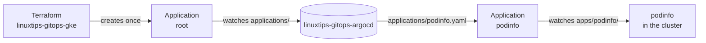

# Module 3: Installing Argo CD and the First Application

## Overview

The GKE platform from Module 2 is ready. Now we install Argo CD on it and start using it.

In this module we will:

- install Argo CD with Terraform, through the same pipeline that created the cluster
- open the Argo CD UI and log in
- create our first Application, first in the UI and then the GitOps way

## Table of Contents

- [Lesson 1: Installing Argo CD with Terraform](#lesson-1-installing-argo-cd-with-terraform)
  - [1. Why Terraform Installs Argo CD](#1-why-terraform-installs-argo-cd)
  - [2. The Terraform Files](#2-the-terraform-files)
  - [3. The Pipeline](#3-the-pipeline)
  - [4. Run It](#4-run-it)
  - [5. Open the Argo CD UI](#5-open-the-argo-cd-ui)
  - [6. Troubleshooting](#6-troubleshooting)
- [Lesson 2: Your First Application in the UI](#lesson-2-your-first-application-in-the-ui)
  - [1. A Quick Tour of the UI](#1-a-quick-tour-of-the-ui)
  - [2. The Application Manifests](#2-the-application-manifests)
  - [3. Create the Application in the UI](#3-create-the-application-in-the-ui)
  - [4. OutOfSync, Then Sync](#4-outofsync-then-sync)
  - [5. See podinfo Running](#5-see-podinfo-running)
  - [6. What the UI Created](#6-what-the-ui-created)
  - [7. Delete It](#7-delete-it)
- [Lesson 3: The Same Application, the GitOps Way](#lesson-3-the-same-application-the-gitops-way)
  - [1. How It Works](#1-how-it-works)
  - [2. The Root Application (Terraform)](#2-the-root-application-terraform)
  - [3. The podinfo Application (Git)](#3-the-podinfo-application-git)
  - [4. Run It](#4-run-it-1)
  - [5. Manual Sync](#5-manual-sync)
  - [6. Drift: Changing the Cluster by Hand](#6-drift-changing-the-cluster-by-hand)
  - [7. Automated Sync and Self-Heal](#7-automated-sync-and-self-heal)
  - [8. Changing the App Through Git](#8-changing-the-app-through-git)
- [Lesson 4: Where to Look When Something Goes Wrong](#lesson-4-where-to-look-when-something-goes-wrong)
  - [1. Sync Status Is Not Health](#1-sync-status-is-not-health)
  - [2. Problem 1: An Image That Doesn't Exist](#2-problem-1-an-image-that-doesnt-exist)
  - [3. Problem 2: A Wrong Path in the Application](#3-problem-2-a-wrong-path-in-the-application)
  - [4. The Logs: application-controller and repo-server](#4-the-logs-application-controller-and-repo-server)
  - [5. Useful Tools](#5-useful-tools)
- [Module Key Takeaways](#module-key-takeaways)

---

# Lesson 1: Installing Argo CD with Terraform

## 1. Why Terraform Installs Argo CD

Argo CD deploys everything from Git, but it can't install itself: something has to put it in the cluster first. That something is Terraform, through the same pipeline that created the network and the cluster.

From then on, the split of responsibilities is:

| Who | Manages |
|---|---|
| **Terraform** (repo `linuxtips-gitops-gke`) | the platform: network, cluster **and Argo CD itself** |
| **Argo CD** (repo `linuxtips-gitops-argocd`) | everything that runs **on** the cluster: add-ons, applications |

Upgrading Argo CD is a commit that changes the chart version, reviewed and applied by the pipeline like any other infrastructure change.

The code is a new folder in **[linuxtips-gitops-gke](https://github.com/LuisGustavoBR/linuxtips-gitops-gke)**:

```txt
# linuxtips-gitops-gke
argocd/
  versions.tf          # Terraform, google and helm provider versions; backend "gcs" {}
  providers.tf         # how Terraform reaches the cluster
  variables.tf
  argocd.tf            # the Helm release
  values/argocd.yaml   # the chart values
  outputs.tf           # the installed chart version
  envs/lab.tfvars      # the values of the lab environment, including the chart version
```

## 2. The Terraform Files

**Reaching the cluster.** Terraform installs Argo CD with the **Helm** provider, which needs to talk to the Kubernetes API. We use the cluster's DNS endpoint (Module 2, Lesson 3) and the access token of whoever runs Terraform: in the pipeline, the `terraform` service account.

```hcl
# argocd/providers.tf (comments removed)
data "google_client_config" "this" {}

data "google_container_cluster" "hub" {
  name     = "${var.name_prefix}-hub"
  location = var.zone
}

provider "helm" {
  kubernetes = {
    host  = "https://${data.google_container_cluster.hub.control_plane_endpoints_config[0].dns_endpoint_config[0].endpoint}"
    token = data.google_client_config.this.access_token
  }
}
```

- `google_client_config` gives the current short-lived access token. No kubeconfig file and no key is involved.
- `google_container_cluster` (a `data` block) looks the cluster up by name, the same way `gke/` finds the network.
- The DNS endpoint uses a publicly trusted certificate, so there is no CA certificate to pass. IAM authorises the token: the `terraform` service account has `roles/container.admin`.

**The Helm release:**

```hcl
# argocd/argocd.tf (comments removed)
resource "helm_release" "argocd" {
  name             = "argocd"
  namespace        = "argocd"
  create_namespace = true

  repository = "https://argoproj.github.io/argo-helm"
  chart      = "argo-cd"
  version    = var.argocd_chart_version

  values = [file("${path.module}/values/argocd.yaml")]

  wait            = true
  timeout         = 600
  atomic          = true
  cleanup_on_fail = true
}
```

| Setting | What it does |
|---|---|
| `repository` + `chart` | the official chart from the Argo project (`argo-helm`) |
| `version` | the exact chart version, from `envs/lab.tfvars`. Never "latest", so nothing changes without a commit |
| `values` | our settings, kept in a separate YAML file that is easy to read and diff |
| `wait` + `timeout` | Terraform waits (up to 10 minutes) until every Argo CD Pod is ready |
| `atomic` + `cleanup_on_fail` | if the install fails, Helm rolls it back instead of leaving a half-installed Argo CD |

**The values:**

```yaml
# argocd/values/argocd.yaml (comments removed)
global:
  nodeSelector:
    node-pool: system

configs:
  params:
    server.insecure: true

dex:
  enabled: false
```

- **`global.nodeSelector`**: every Argo CD component runs on the on-demand `system` pool (label `node-pool: system`, set in Module 2), never on Spot nodes that can disappear.
- **`server.insecure: true`**: the Argo CD server speaks plain HTTP inside the cluster. For now we reach it with `kubectl port-forward`, which is already an encrypted tunnel. Later, TLS will end at the load balancer in front of it.
- **`dex.enabled: false`**: Dex is the SSO component (log in with GitHub, for example). It stays off until we set up SSO.

All the other options keep the chart defaults. The full list is in the chart's [values.yaml](https://github.com/argoproj/argo-helm/blob/main/charts/argo-cd/values.yaml).

**The chart version, per environment:**

```hcl
# argocd/envs/lab.tfvars
region      = "us-central1"
zone        = "us-central1-a"
name_prefix = "gitops"

argocd_chart_version = "10.18.0" # Argo CD v3.6.1
```

The version lives in the environment file on purpose. With more than one environment, an upgrade can be tested in one of them before the others.

## 3. The Pipeline

`argocd` is one more job in `terraform.yaml`, using the same reusable workflow, and it runs after `gke`:

```yaml
# .github/workflows/terraform.yaml (excerpt)
  argocd:
    needs: [checks, changes, gke]
    if: ${{ !failure() && !cancelled() && needs.changes.outputs.argocd == 'true' }}
    uses: ./.github/workflows/_terraform.yaml
    with:
      dir: argocd
    permissions:
      contents: read
      id-token: write
```

The `checks` and `changes` jobs also gained `argocd` in their folder lists.

The destroy workflow now removes Argo CD **before** the cluster, the reverse of the creation order:

```yaml
# .github/workflows/destroy.yaml (excerpt)
jobs:
  argocd:
    uses: ./.github/workflows/_terraform.yaml
    with:
      dir: argocd
      destroy: true
    ...
  gke:
    needs: argocd
    uses: ./.github/workflows/_terraform.yaml
    with:
      dir: gke
      destroy: true
```

## 4. Run It

The cluster must be running. If you destroyed it, run **Actions → terraform → Run workflow** first.

```bash
git add .github argocd
git commit -m "feat: install argo cd with terraform"
git push
```

This push changes the workflows, so every folder runs. `network` and `gke` plan `No changes`; approve them to move on. Then approve **argocd / plan** and read the summary. There is one resource to create:

```txt
  # helm_release.argocd will be created
  + resource "helm_release" "argocd" {
      + chart            = "argo-cd"
      + name             = "argocd"
      + namespace        = "argocd"
      + repository       = "https://argoproj.github.io/argo-helm"
      + version          = "10.18.0"
      ...
    }

Plan: 1 to add, 0 to change, 0 to destroy.
```

Approve **argocd / apply**. It takes two or three minutes, while Terraform waits for the Pods. It ends with:

```txt
Apply complete! Resources: 1 added, 0 changed, 0 destroyed.

Outputs:

chart_version = "10.18.0"
```

## 5. Open the Argo CD UI

In the Cloud Shell, connect `kubectl` to the cluster (if you haven't yet) and look at the Argo CD Pods:

```bash
gcloud container clusters get-credentials gitops-hub \
  --location us-central1-a --project "$PROJECT_ID" --dns-endpoint

kubectl get pods -n argocd -o wide
```

```txt
NAME                                                READY   STATUS    NODE
argocd-application-controller-0                     1/1     Running   gke-gitops-hub-system-...
argocd-applicationset-controller-7c9f8d6b5-x2k8p    1/1     Running   gke-gitops-hub-system-...
argocd-notifications-controller-5d8b7c4f9-q7lzn     1/1     Running   gke-gitops-hub-system-...
argocd-redis-6b7d9f8c5-m4w2t                        1/1     Running   gke-gitops-hub-system-...
argocd-repo-server-84f6c7d9b-tr5vk                  1/1     Running   gke-gitops-hub-system-...
argocd-server-6f9b8c7d4-hn3jx                       1/1     Running   gke-gitops-hub-system-...
```

Every Pod runs on the `system` node. These are the components from [Module 1](../01%20-%20GitOps%20Fundamentals%20and%20Argo%20CD%20Architecture/README.md#3-the-components), without Dex, which is off for now.

**Get the admin password.** Argo CD generates a random password at install time and stores it in a Secret. It is base64-encoded, like every Secret value:

```bash
kubectl get secret argocd-initial-admin-secret -n argocd \
  -o jsonpath='{.data.password}' | base64 -d; echo
```

**Open the UI.** Create a tunnel from the Cloud Shell to the Argo CD server:

```bash
kubectl port-forward -n argocd svc/argocd-server 8080:80
```

Then click **Web Preview** (the eye icon at the top of the Cloud Shell) → **Preview on port 8080**. The Argo CD login page opens in a new tab. Log in with user `admin` and the password from above.

The tunnel lives as long as the command runs. Press `Ctrl+C` to close it.

> **Note:** On your own machine, the same `port-forward` works after `get-credentials`; then open `http://localhost:8080`.

The Applications page is empty for now: there is nothing in Git for Argo CD to deploy yet. That is the next lesson.

## 6. Troubleshooting

| Error | Likely cause | Fix |
|---|---|---|
| `argocd / plan`: `Error reading Container Cluster` / `not found` | the cluster is not running (it was destroyed) | run **Actions → terraform → Run workflow** to recreate it first |
| `Kubernetes cluster unreachable` / `403 Forbidden` | the `terraform` service account can't use the Kubernetes API | Module 2, Lesson 1, step 5: `roles/container.admin` |
| `context deadline exceeded` / timeout while installing | a Pod didn't become ready in 10 minutes (for example, the `system` node is not ready) | `kubectl get pods -n argocd` and `kubectl describe pod ...` to see why |
| Pods stuck in `Pending` with `node(s) didn't match Pod's node affinity/selector` | no node has the `node-pool: system` label | check the `system` pool in `gke/node_pools.tf` |
| Web Preview shows an error | the `port-forward` is not running, or it uses another port | run the `port-forward` command again, on port 8080 |

## Key Takeaways

- Argo CD can't install itself: Terraform installs it, through the same pipeline as the rest of the platform.
- Terraform reaches the cluster through its DNS endpoint with a short-lived token. No kubeconfig and no keys.
- The chart version is pinned per environment, so an upgrade is a reviewed commit.
- Every Argo CD component runs on the on-demand `system` pool.
- The initial admin password is in the `argocd-initial-admin-secret` Secret, and the UI is reachable with `kubectl port-forward` and the Cloud Shell Web Preview.

---

# Lesson 2: Your First Application in the UI

Time to deploy something. We start with the simplest possible application, and we create it **in the Argo CD UI**: the form shows every field of an Application, which is the best way to learn them.

At the end we delete it. An Application created by clicking is not in Git, which goes against everything from Module 1. In the next lesson we create it the right way.

## 1. A Quick Tour of the UI

Open the UI (Lesson 1, section 5) and look around:

| Page | What it is for |
|---|---|
| **Applications** | the list of Applications. Each card shows the sync status (*Synced* / *OutOfSync*) and the health (*Healthy*, *Progressing*, *Degraded*...) from Module 1 |
| **Settings → Repositories** | Git and Helm repositories that need credentials. Our repositories are public, so nothing is needed here |
| **Settings → Clusters** | clusters Argo CD can deploy to. There is one: `in-cluster`, the cluster Argo CD itself runs in (`https://kubernetes.default.svc`) |
| **Settings → Projects** | AppProjects group Applications and limit what they can do. For now there is only `default`, which allows everything |
| **User Info** | who you are logged in as. You can switch to a dark theme here |

On every Application there are two buttons we use all the time:

| Button | What it does |
|---|---|
| **Refresh** | compares Git with the cluster now, instead of waiting for the next cycle (the *refresh* step from Module 1) |
| **Sync** | applies what is in Git to the cluster (the *sync* step) |

## 2. The Application Manifests

What we deploy lives in the **[linuxtips-gitops-argocd](https://github.com/LuisGustavoBR/linuxtips-gitops-argocd)** repository, the one Argo CD watches:

```txt
# linuxtips-gitops-argocd
apps/
  podinfo/
    deployment.yaml
    service.yaml
```

Two plain Kubernetes YAML files: no Helm, no Kustomize. The app is [podinfo](https://github.com/stefanprodan/podinfo), a small web app made for Kubernetes demos.

```yaml
# apps/podinfo/deployment.yaml (excerpt)
spec:
  replicas: 2
  ...
      containers:
        - name: podinfo
          image: ghcr.io/stefanprodan/podinfo:6.17.0
          ports:
            - name: http
              containerPort: 9898
          env:
            - name: PODINFO_UI_MESSAGE
              value: "Hello from Argo CD"
```

- Two replicas of the podinfo image, with a **fixed version** (`6.17.0`), never `latest`.
- `PODINFO_UI_MESSAGE` is shown on the podinfo web page. Later we change it in Git and watch the new value reach the cluster.
- The full file also has health probes (`/readyz`, `/healthz`) and resource requests.

```yaml
# apps/podinfo/service.yaml (excerpt)
spec:
  selector:
    app: podinfo
  ports:
    - name: http
      port: 80
      targetPort: http
```

A `ClusterIP` Service: port 80 inside the cluster, sent to port 9898 of the Pods.

> **Note:** The manifests have **no namespace**. The namespace is decided by the Application (its destination), so the same files can be deployed anywhere.

## 3. Create the Application in the UI

Click **+ New App** and fill in:

| Section | Field | Value | Why |
|---|---|---|---|
| General | Application Name | `podinfo-ui` | any name |
| General | Project Name | `default` | projects come later |
| General | Sync Policy | `Manual` | so we can see the two steps of the loop separately |
| General | Sync Options | ✅ **Auto-Create Namespace** | our manifests don't create the namespace |
| Source | Repository URL | `https://github.com/LuisGustavoBR/linuxtips-gitops-argocd.git` | the repository Argo CD watches |
| Source | Revision | `HEAD` | the latest commit of the default branch |
| Source | Path | `apps/podinfo` | the folder with the manifests |
| Destination | Cluster URL | `https://kubernetes.default.svc` | the cluster Argo CD runs in |
| Destination | Namespace | `podinfo-ui` | where the app goes |

After you paste the repository URL, the **Revision** and **Path** fields start suggesting values. That is the **repo-server** (Module 1) already cloning the repository and finding the folders with manifests.

Below, the form shows a **Directory** section, because `apps/podinfo` contains plain YAML files. Argo CD detects the type of source by itself:
- plain YAML (a directory)
- Kustomize (a `kustomization.yaml`)
- Helm (a `Chart.yaml`)

Leave it as it is and click **Create**.

## 4. OutOfSync, Then Sync

The new Application appears as **OutOfSync** and **Missing**:

- **OutOfSync**: the *refresh* step ran. Argo CD read Git and knows the cluster doesn't match it.
- **Missing**: the resources don't exist in the cluster yet.

Nothing was deployed, because the sync policy is manual. Argo CD did step 1 of the loop and is waiting for us to do step 2.

Open the Application: the tree shows the Deployment and the Service, both yellow (out of sync). Click **Sync** → **Synchronize**.

Argo CD creates the namespace and the resources. After a few seconds, the Application turns **Synced** and **Healthy**, and the tree grows: Deployment → ReplicaSet → Pods. The ReplicaSet and the Pods are not in Git; Kubernetes created them from the Deployment, and Argo CD shows them so you can see the whole picture.

## 5. See podinfo Running

In the Cloud Shell:

```bash
kubectl get all -n podinfo-ui
```

```txt
NAME                           READY   STATUS    RESTARTS   AGE
pod/podinfo-6d9c8b7f5d-8kx2m   1/1     Running   0          40s
pod/podinfo-6d9c8b7f5d-tq7wn   1/1     Running   0          40s

NAME              TYPE        CLUSTER-IP     PORT(S)   AGE
service/podinfo   ClusterIP   10.30.21.147   80/TCP    40s

NAME                      READY   UP-TO-DATE   AVAILABLE   AGE
deployment.apps/podinfo   2/2     2            2           40s
...
```

To open podinfo in the browser, open a **second Cloud Shell tab** (the `+` button), because the first one is busy with the Argo CD port-forward, and run:

```bash
kubectl port-forward -n podinfo-ui svc/podinfo 8081:80
```

Then **Web Preview → Change port → 8081**. The podinfo page shows the message **"Hello from Argo CD"** and the name of the Pod that answered.

## 6. What the UI Created

The form didn't do anything magic: it created an **Application** resource in the cluster. You can see it under **App Details → Manifest**, or with `kubectl`:

```bash
kubectl get applications -n argocd
kubectl get application podinfo-ui -n argocd -o yaml
```

Without the fields Kubernetes and Argo CD add by themselves (`status`, `metadata.uid`, `creationTimestamp`...), this is what is left:

```yaml
# kubectl get application podinfo-ui -n argocd -o yaml (cleaned up)
apiVersion: argoproj.io/v1alpha1
kind: Application
metadata:
  name: podinfo-ui
  namespace: argocd
spec:
  project: default
  destination:
    server: https://kubernetes.default.svc
    namespace: podinfo-ui
  source:
    repoURL: https://github.com/LuisGustavoBR/linuxtips-gitops-argocd.git
    targetRevision: HEAD
    path: apps/podinfo
  syncPolicy:
    syncOptions:
      - CreateNamespace=true
```

Every field of the form is here, and it is the **where / what / how** from Module 1:

- **`destination`** is *where*: the cluster Argo CD runs in, namespace `podinfo-ui`.
- **`source`** is *what*: this repository, at `HEAD`, folder `apps/podinfo`.
- **`syncPolicy`** is *how*: manual (there is no `automated` block), creating the namespace.

Note that the Application itself lives in the `argocd` namespace, where Argo CD runs, while the app goes to `podinfo-ui`.

## 7. Delete It

This Application exists only in the cluster. Nobody reviewed it, there is no history of it, and if the cluster were recreated tonight it would be gone. So we delete it:

1. Stop the podinfo port-forward (`Ctrl+C` in the second tab).
2. In the UI, open `podinfo-ui` → **Delete**.
3. Type the name to confirm, and keep the propagation policy **Foreground**: Argo CD deletes the app's resources (Deployment, Service...) before the Application.

```bash
kubectl get all -n podinfo-ui   # No resources found
```

The namespace `podinfo-ui` stays, because Argo CD created it as a side effect of `CreateNamespace` and doesn't track it as part of the app. Remove it with `kubectl delete namespace podinfo-ui`, or leave it: it costs nothing.

## Key Takeaways

- The **New App** form is just a friendly way to write an `Application` resource.
- With a manual sync policy, Argo CD shows *OutOfSync* and waits for you to press **Sync**.
- The repo-server clones the repository and detects the type of source by itself: plain YAML, Kustomize or Helm.
- Manifests without a namespace can be deployed anywhere; the Application decides where.
- Applications created by clicking are not in Git. Use the UI to learn and to look, not to change things.

---

# Lesson 3: The Same Application, the GitOps Way

In Lesson 2 the Application existed only in the cluster. Now it becomes **a file in Git**, and Git becomes the only way to change it.

## 1. How It Works

There is one problem to solve first: who creates the Applications that live in Git? Running `kubectl apply` by hand would be a manual step again.

The answer is a single Application, called **root**, created by Terraform. Its only job is to watch the `applications/` folder of the gitops repository. Every Application file committed there is created by Argo CD:



The `root` Application is the last thing created outside Git. From now on, adding an Application is just committing a file to `applications/`.

> **Note:** An Application that creates other Applications is called the **app of apps** pattern, and the Argo CD documentation calls the top one the **root** Application. We use its simplest form here, and come back to it in more detail later.

## 2. The Root Application (Terraform)

It lives next to the Argo CD installation, in **[linuxtips-gitops-gke](https://github.com/LuisGustavoBR/linuxtips-gitops-gke)**:

```hcl
# argocd/root.tf (comments removed)
resource "helm_release" "root" {
  name      = "argocd-root"
  namespace = helm_release.argocd.namespace

  repository = "https://argoproj.github.io/argo-helm"
  chart      = "argocd-apps"
  version    = var.argocd_apps_chart_version

  values = [yamlencode({
    applications = {
      root = {
        namespace = helm_release.argocd.namespace
        project   = "default"
        source = {
          repoURL        = var.gitops_repo_url
          targetRevision = var.gitops_repo_revision
          path           = "applications"
        }
        destination = {
          server    = "https://kubernetes.default.svc"
          namespace = helm_release.argocd.namespace
        }
        syncPolicy = {
          automated = {
            prune    = true
            selfHeal = true
          }
        }
      }
    }
  })]
}
```

- **`argocd-apps`** is the official chart for creating Applications with Helm. Why not write the Application as a raw Kubernetes manifest in Terraform? Because the `Application` type only exists after Argo CD is installed, which happens in the same `apply`, and Terraform would fail at plan time.
- **`source`**: the gitops repository, branch `main`, folder `applications`.
- **`destination`**: the Application files it reads are created in the `argocd` namespace, where Applications must live.
- **`automated` + `prune` + `selfHeal`**: a file added to `applications/` is created automatically, a file removed is deleted, and nobody can change these Applications by hand.

The repository and branch come from the environment file:

```hcl
# argocd/envs/lab.tfvars (excerpt)
argocd_apps_chart_version = "2.0.8"

gitops_repo_url      = "https://github.com/LuisGustavoBR/linuxtips-gitops-argocd.git"
gitops_repo_revision = "main"
```

## 3. The podinfo Application (Git)

In **[linuxtips-gitops-argocd](https://github.com/LuisGustavoBR/linuxtips-gitops-argocd)**:

```txt
# linuxtips-gitops-argocd
applications/
  podinfo.yaml         # the Application (new)
apps/
  podinfo/             # what it deploys (Lesson 2)
    deployment.yaml
    service.yaml
```

```yaml
# applications/podinfo.yaml
apiVersion: argoproj.io/v1alpha1
kind: Application
metadata:
  name: podinfo
  namespace: argocd
spec:
  project: default
  source:
    repoURL: https://github.com/LuisGustavoBR/linuxtips-gitops-argocd.git
    targetRevision: main
    path: apps/podinfo
  destination:
    server: https://kubernetes.default.svc
    namespace: podinfo
  syncPolicy:
    # automated:
    #   prune: true
    #   selfHeal: true
    syncOptions:
      - CreateNamespace=true
```

It is the same Application from Lesson 2, with two differences:

- **`targetRevision: main`** instead of `HEAD`. It names the branch explicitly, which is clearer when there are other branches.
- **`automated` is commented out**: we start with a manual sync on purpose, to see drift first.

## 4. Run It

First the gitops repository, so the `applications/` folder exists when Argo CD looks for it:

```bash
cd linuxtips-gitops-argocd
git add applications
git commit -m "feat: add podinfo application"
git push
```

Then the infrastructure repository:

```bash
cd linuxtips-gitops-gke
git add argocd
git commit -m "feat: add root application"
git push
```

Only `argocd/` changed, so only the `argocd` jobs run. Approve **argocd / plan**. One resource to create:

```txt
  # helm_release.root will be created
  ...
Plan: 1 to add, 0 to change, 0 to destroy.
```

Approve **argocd / apply**.

Open the Argo CD UI. There are two Applications:

| Application | Status | Why |
|---|---|---|
| `root` | Synced, Healthy | it found `applications/podinfo.yaml` and created the `podinfo` Application |
| `podinfo` | **OutOfSync**, Missing | its sync is manual, so it waits for us |

## 5. Manual Sync

Open `podinfo` and click **Sync → Synchronize**. After a few seconds it turns **Synced** and **Healthy**:

```bash
kubectl get all -n podinfo
```

The difference from Lesson 2: nobody filled in a form. The Application came from a file in Git, created by `root`.

## 6. Drift: Changing the Cluster by Hand

Now let's do what GitOps exists to prevent, on purpose, to see how Argo CD reacts. Delete the Deployment by hand:

```bash
kubectl delete deployment podinfo -n podinfo
```

Click **Refresh** on `podinfo`. It turns **OutOfSync**, and the Deployment shows as **Missing**. Argo CD noticed that the cluster no longer matches Git. This difference is called **drift**.

With a manual sync policy, Argo CD only **reports** the drift. The app stays broken until someone clicks **Sync**. Click it to bring the Deployment back.

## 7. Automated Sync and Self-Heal

Now let Argo CD fix drift by itself. In `applications/podinfo.yaml`, uncomment the `automated` block:

```yaml
# applications/podinfo.yaml (excerpt)
  syncPolicy:
    automated:
      prune: true
      selfHeal: true
    syncOptions:
      - CreateNamespace=true
```

```bash
git commit -am "feat: enable automated sync for podinfo"
git push
```

`root` picks up the change within a few minutes (click **Refresh** on `root` to speed it up), and the `podinfo` Application now shows **Auto sync is enabled**.

| Option | What it does |
|---|---|
| `automated` | Argo CD syncs as soon as a refresh finds a difference between Git and the cluster |
| `selfHeal: true` | changes made directly in the cluster are reverted to what Git says |
| `prune: true` | a resource removed from Git is deleted from the cluster. Without it, it would be left behind and the app would show OutOfSync |

Test self-heal by deleting the Deployment again:

```bash
kubectl delete deployment podinfo -n podinfo
kubectl get deployment podinfo -n podinfo -w
```

It comes back by itself within seconds. `Ctrl+C` stops the `-w` (watch). That is GitOps working: the only way to change this app now is through Git.

## 8. Changing the App Through Git

The other direction: a change in Git reaches the cluster without anyone touching it. In `apps/podinfo/deployment.yaml`, change the message:

```yaml
# apps/podinfo/deployment.yaml (excerpt)
          env:
            - name: PODINFO_UI_MESSAGE
              value: "Deployed by Argo CD from Git"
```

```bash
git commit -am "feat: change podinfo message"
git push
```

Within a few minutes (or right away, with **Refresh** on `podinfo`), Argo CD applies the change and Kubernetes replaces the Pods with new ones. Open podinfo to see the new message:

```bash
kubectl port-forward -n podinfo svc/podinfo 8081:80
```

Then **Web Preview → Change port → 8081**.

Look at the `podinfo` Application in the UI: **Last Sync** shows the commit that was deployed. Git history is now the deployment history, and going back is a `git revert`.

## Key Takeaways

- A single **root** Application, created by Terraform, watches a folder in Git and creates every Application committed there. It is the last thing created outside Git.
- Creating an Application is now a commit; nobody runs `kubectl apply` or clicks **New App**.
- With a manual policy, Argo CD detects **drift** and waits; with `automated` + `selfHeal`, it fixes drift by itself; `prune` deletes what was removed from Git.
- A change in Git reaches the cluster on its own, and Git history becomes the deployment history.

---

# Lesson 4: Where to Look When Something Goes Wrong

A big part of daily work with Argo CD is troubleshooting. In this lesson we break podinfo on purpose, **through Git**, the way real problems arrive, and look at where each problem shows up.

The two problems are different on purpose:

| Problem | Argo CD can apply it? | What breaks |
|---|---|---|
| An image that doesn't exist | **yes**: the app is *Synced* | the app is not *Healthy* (Kubernetes can't run it) |
| A wrong path in the Application | **no** | Argo CD can't even generate the manifests (*ComparisonError*) |

## 1. Sync Status Is Not Health

Module 1 introduced two separate statuses. Troubleshooting starts by knowing which one is wrong:

| Status | Answers | Values |
|---|---|---|
| **Sync status** | does the cluster match Git? | Synced, OutOfSync, Unknown |
| **Health** | is what's running working? | Healthy, Progressing, Degraded, Missing |

An app can be **Synced** and **Degraded** at the same time: Argo CD applied exactly what Git says, but what Git says doesn't work.

The fastest way to see both, besides the UI:

```bash
kubectl get applications -n argocd
```

```txt
NAME      SYNC STATUS   HEALTH STATUS
podinfo   Synced        Healthy
root      Synced        Healthy
```

## 2. Problem 1: An Image That Doesn't Exist

In `linuxtips-gitops-argocd`, change the podinfo image to a version that doesn't exist:

```yaml
# apps/podinfo/deployment.yaml (excerpt)
          image: ghcr.io/stefanprodan/podinfo:9.9.9
```

```bash
git commit -am "test: break podinfo image"
git push
```

Click **Refresh** on `podinfo` (or wait a few minutes). Argo CD applies the change, since automated sync is on, and the result is:

- **Sync status: Synced.** The Deployment in the cluster has exactly the image Git asked for.
- **Health: Progressing**, and later **Degraded**. The new Pod never starts.

**Where to look.** In the UI, open `podinfo` and follow the tree: Deployment → the **new** ReplicaSet → its Pod, with a broken heart icon. Click the Pod: the **Events** tab says why. In the terminal:

```bash
kubectl get pods -n podinfo
```

```txt
NAME                       READY   STATUS             RESTARTS   AGE
podinfo-6d9c8b7f5d-8kx2m   1/1     Running            0          1h
podinfo-6d9c8b7f5d-tq7wn   1/1     Running            0          1h
podinfo-7f8e9a6b4c-z2x9k   0/1     ImagePullBackOff   0          2m
```

```bash
kubectl describe pod -n podinfo -l app=podinfo | grep -A3 "Failed"
```

The events say the image `ghcr.io/stefanprodan/podinfo:9.9.9` was **not found**.

Notice that **podinfo is still answering**. Kubernetes replaces Pods gradually (*rolling update*): it starts a new Pod first and only removes an old one when the new one is ready. Since the new one never gets ready, the old ones keep running. The health stays *Progressing* until the Deployment's deadline (10 minutes by default), and then it turns *Degraded*.

**The fix is in Git**, like the change was:

```bash
git revert HEAD --no-edit
git push
```

After a refresh, the new ReplicaSet is scaled down and the app is **Healthy** again. `git revert` creates a new commit that undoes the previous one, so the history keeps both the mistake and the fix.

## 3. Problem 2: A Wrong Path in the Application

Now break the Application itself. In `applications/podinfo.yaml`, misspell the path:

```yaml
# applications/podinfo.yaml (excerpt)
    path: apps/podinf
```

```bash
git commit -am "test: break podinfo path"
git push
```

`root` updates the `podinfo` Application (click **Refresh** on `root`, then on `podinfo`). This time:

- **Sync status: Unknown.** Argo CD can't compare anything, because it couldn't build the desired state.
- The app shows a **ComparisonError** condition, with a message saying the app path `apps/podinf` doesn't exist.

Nothing in the cluster changed. Argo CD never applies something it couldn't render, so podinfo keeps running the last good version. **Prune doesn't delete anything** either: an empty or broken source is an error, not "Git wants zero resources".

You can also read the condition without the UI:

```bash
kubectl describe application podinfo -n argocd
```

Look at the **Conditions** and **Events** sections near the end.

Fix it the same way:

```bash
git revert HEAD --no-edit
git push
```

## 4. The Logs: application-controller and repo-server

The UI and `kubectl describe` show the result. The logs show the process, which helps when the message isn't clear. The two components from Module 1 split the work:

| Component | Its logs explain |
|---|---|
| `argocd-application-controller` | the reconciliation: comparisons, syncs, health. Problems like *Degraded*, sync failures, permission errors when applying |
| `argocd-repo-server` | talking to Git and rendering manifests. Problems like *ComparisonError*: path not found, invalid YAML, broken Kustomize or Helm |

The application controller runs as a **StatefulSet**, the repo-server as a **Deployment**:

```bash
kubectl logs -n argocd statefulset/argocd-application-controller -f
kubectl logs -n argocd deploy/argocd-repo-server -f
```

`-f` keeps following the log; `Ctrl+C` stops it. During a normal refresh, the application controller logs lines like:

```txt
level=info msg="Comparing app state (cluster: https://kubernetes.default.svc, namespace: podinfo)" application=argocd/podinfo
level=info msg="Reconciliation completed" application=argocd/podinfo ...
```

Every line has `application=argocd/<name>`, so you can filter for one app:

```bash
kubectl logs -n argocd statefulset/argocd-application-controller --since=10m | grep "application=argocd/podinfo"
```

> **Note:** A good habit is to repeat Problem 2 while following the repo-server logs. You will see the same "app path does not exist" error there, with more context, which is where you would look first in a real incident.

## 5. Useful Tools

These are optional, but they make troubleshooting faster, especially once there is more than one cluster:

| Tool | Why |
|---|---|
| [stern](https://github.com/stern/stern) | follows the logs of many Pods at once, matched by name: `stern -n argocd application-controller` |
| [kube-ps1](https://github.com/jonmosco/kube-ps1) | shows the current cluster and namespace in the shell prompt, so you always know where your commands go |
| [kubectx and kubens](https://github.com/ahmetb/kubectx) | switch cluster or namespace quickly. GKE context names are long (`gke_<project>_us-central1-a_gitops-hub`), so give them short names: `kubectx hub=gke_<project>_us-central1-a_gitops-hub` |
| [k9s](https://k9scli.io/) | a terminal UI for the cluster, if you prefer it to plain `kubectl` |

## Key Takeaways

- Check **which status** is wrong first: sync status (does the cluster match Git?) or health (does it work?).
- *Synced* + *Degraded* means Git asked for something that doesn't work. Look at the Pods and their events.
- *Unknown* + *ComparisonError* means Argo CD couldn't render the source. Nothing is applied, and the last good version keeps running.
- The application controller's logs explain reconciliation and health; the repo-server's logs explain rendering problems.
- Problems that arrive through Git are fixed through Git: `git revert` keeps both the mistake and the fix in the history.

---

# Module Key Takeaways

- Terraform installs Argo CD and a single **root** Application; everything else comes from Git.
- The UI is the best way to learn the fields of an Application, but changes always go through Git.
- An Application is *where* (`destination`), *what* (`source`) and *how* (`syncPolicy`).
- With `automated` + `selfHeal` + `prune`, the cluster follows Git in both directions: drift is reverted and changes are applied.
- When something breaks, check sync status and health separately, then the Pods' events, then the logs of the application controller and the repo-server.
